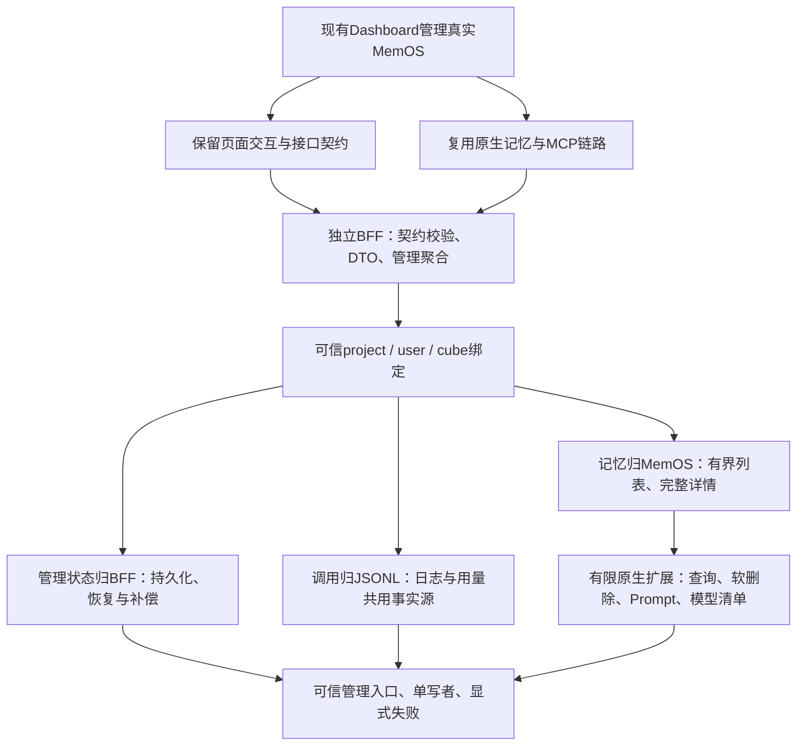

# Dashboard 整体设计思路

## 目标与约束

Issue #1 的目标是用现有 Dashboard 管理真实 MemOS 数据，覆盖记忆、工作区、凭据、调用日志和用量。方案保留原版前端，通过 `VITE_API_BASE` 连接独立 `server/live/` BFF，并复用原生记忆生产与检索链路。

设计先区分四类需求：可直接复用的原生能力、需要转换的页面视图、需要补齐的原生能力，以及 Issue 允许的占位范围。原37-operation契约作为适配边界，模型清单通过补充契约提供。

## 为什么采用独立 BFF

| 方案 | 收益 | 取舍 |
| --- | --- | --- |
| 前端直接适配 MemOS REST | 少一个部署进程 | 页面需要理解原生协议与存储语义，改动扩散到前端 |
| 将全部 Dashboard 接口加入 MemOS | 在一个服务中提供接口 | UI管理状态和报表契约进入记忆引擎，增加上游升级耦合 |
| **独立 BFF + 有限原生扩展** | 保持前端契约稳定，集中适配与管理聚合，分别测试和部署 | 增加进程及配置边界，BFF和原生扩展需兼容部署 |

Mock作为独立开发后端保留，用于页面开发和契约基线。Live依赖真实上游，在缺失能力、数据协议不一致或依赖失败时返回明确错误。

## 数据归属与身份

- **记忆内容、ID、原生类型和状态**来自MemOS及Neo4j/Qdrant。BFF提供视图与管理操作，避免另建一套记忆内容库。
- **调用事实**来自网关JSONL。BFF统一解析后生成日志和UTC日统计，失败调用也计入调用事实。
- **管理元数据**由BFF持久化，包括工作区绑定、显示及选择状态、密钥元数据、模板和创建恢复日志。有效MCP凭据由共享网关registry控制。
- **Prompt覆盖配置**按user/cube保存在原生扩展；生成草稿、保存、调试和正常写入生效分别验证。模板CRUD与原生画像生产接入范围分别确认。

`projectId`表示管理视图，`userId/cubeId`表示原生作用域，审计中的tenant/cube/key表示调用归属。BFF从可信配置解析身份；网关从凭据确定身份并写入审计。缺少历史cube/key的记录保留未知归属，避免用当前registry改写历史。

管理BFF面向可信私网或受认证的访问入口；工作区过滤限制配置的数据范围。CORS承担来源限制，外层访问控制承担用户认证。

## 按执行位置划分能力

展示转换、接口契约和统计聚合放在BFF；需要存储执行或原生运行时信息的能力放在私有扩展：

| 能力 | 实现落点 | 设计理由 |
| --- | --- | --- |
| 过滤、计数、排序、分页 | Neo4j受控查询 | 数据库先缩小结果集，限制网络传输与BFF内存 |
| 列表与详情 | 列表受限投影；详情精确ID查询 | 翻页使用小响应，查看单条时保留完整内容 |
| 记忆标签 | BFF/原生查询中的明确类型映射 | 保留原生类型；事件和画像可与文本视图重叠 |
| 指定ID软删除 | 原生图与向量存储扩展 | 同步删除状态，保留节点与向量，显式报告部分失败 |
| 模型清单 | 已初始化MemOS组件 | 展示实际配置，限制字段输出；推理健康另行验证 |
| Prompt | 受支持的原生抽取路径 | 配置真正进入同步纯文本精细抽取；其他生产路径单独界定 |
| 审计与用量 | 同一JSONL解析结果 | 明确全事件计数、历史归属和不完整诊断 |

原生扩展使用服务端私有令牌。BFF组织业务流程，避免浏览器直接访问数据库或持有管理令牌。

## 一致性、部署与演进

当前使用单写者文件状态，降低额外基础设施成本。写入先持久化再发布内存；跨系统操作通过恢复日志和补偿处理部分成功：

- 工作区创建先记录计划cube身份，原生确认后登记本地映射；模糊超时按确切ID核对。
- 密钥创建失败时补偿元数据；撤销后保持凭据失效，再处理展示状态清理。
- 图/向量软删除同步失败显式返回，由操作者按确切作用域检查和重试；既有MCP/legacy删除语义保持不变。

多实例并发写入需要升级管理存储及协调机制。当前JSONL解析有文件体积与轮转边界，高吞吐审计可演进为索引化存储。查询下推限制传输体积，文本搜索和计数仍可能扫描作用域内节点。

代码分层为路由与公共校验、领域服务、外部适配器、持久化仓储，由`app.ts`组装依赖。TypeScript共享类型约束内部调用，OpenAPI/Ajv校验外部输入；组件测试、原生集成和浏览器验证分别检查协议、真实语义和页面表现。

配置及运行边界见[架构说明](ARCHITECTURE.md)、[部署与恢复](REVIEW-DEPLOYMENT-NOTES.md)、[Prompt范围](PROMPTS.md)和[测试说明](testing.md)。
