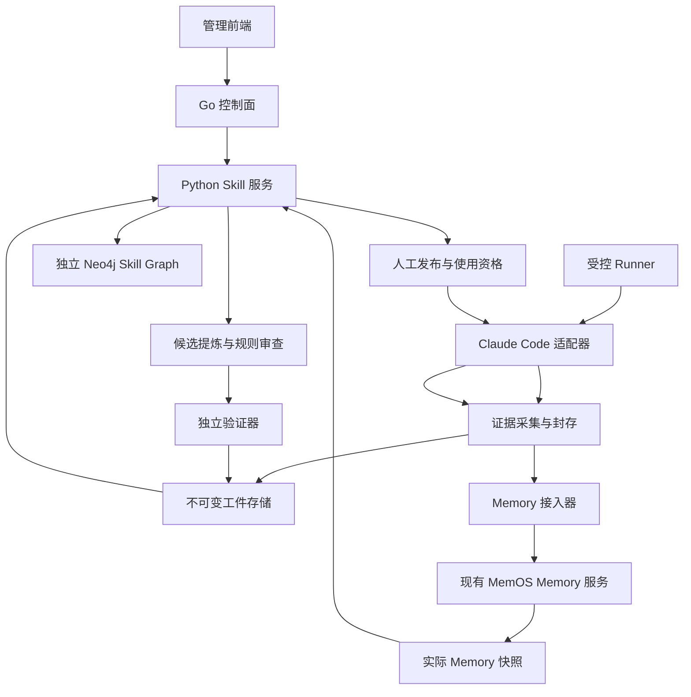
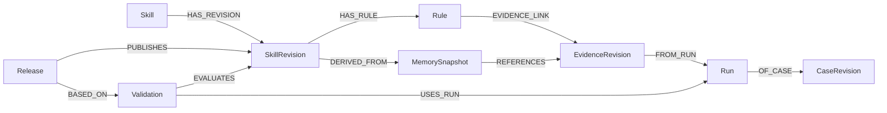

# Agent Memory 驱动的 Skill 提炼与演进设计

文档版本：0.1。日期：2026-11-08。对应 [MemOS issue 6](https://github.com/hugegraph/MemOS/issues/6) 的阶段二具体方案设计。

本方案面向项目维护者、实现者和验收者，设计一条从受控研发任务中采集经验、写入 MemOS、提炼可追溯的过程性 Skill、在 Claude Code 中使用、独立验证并持续演进的链路。首版聚焦 Python mock/fixture 故障中的契约一致性诊断与修复，使用独立 Neo4j 保存 Skill Graph，自动生成候选，由人决定发布。

核心验收原则：**修复必须恢复正确行为，并保留发现真实错误的能力。** 测试变绿、Agent 自述成功、格式检查通过，都不能单独证明修复正确或 Skill 有效。

## 1 设计状态与交付边界

本文件中的“已定”表示方案决策已确定，不表示对应功能已经实现。Claude Code 实际接入、案例快照制作、数据库事务行为和效果实验仍属于阶段三工作。

| 标记 | 含义 | 使用方式 |
| --- | --- | --- |
| F 已冻结 | 前序讨论已确定的核心决策 | 实现遵守；变化需记录原因与影响 |
| D 本次细化 | 为可实现、可验收补全的契约、任务规范和工作包 | 作为阶段二设计基线；不等同于实测结论 |
| V 待验证 | 必须由真实运行、集成测试或实验关闭的问题 | 指定验证阶段与失败后的处理 |
| O 待输入 | 期限、资源或具体版本等尚未提供的信息 | 不据此编造排期或兼容性声明 |

F 决策包括：Claude Code 为首个 Agent；受控任务自动采集；Python 测试修复为场景；严格 Fake 契约诊断为首个 Skill；最小证据包；逐规则证据；人工发布；九类 Skill Graph 核心节点；独立 Neo4j；固定版本加载；三组对照；版本替代、暂停、撤回与精确依赖传播。

D 决策包括：三部分服务职责、跨存储写入流程、适配器输入输出和错误语义、固定任务规范、评分分母、工作包及阶段验收。V 项目集中列于第 15 节。

阅读导航：[目标](#2-问题定义与目标)、[架构](#4-整体架构与主要流程)、[证据](#5-最小案例证据包)、[提炼](#6-经验资格与-skill-提炼)、[表达](#7-skill-表达与组织)、[Skill Graph](#8-skill-graph)、[适配器](#9-claude-code-与控制面适配)、[发布](#10-正确性检查与人工发布)、[实验](#11-固定任务与效果评估协议)、[演进](#12-持续演进与失效处理)、[实施计划](#14-实施工作包与阶段验收)、[需求覆盖](#16-issue-问题与交付物覆盖)。

## 2 问题定义与目标

### 2.1 要解决的问题

现有 Memory 能保存和检索任务相关内容，但单条记忆未必具有完整过程、可靠验收、独立样本身份或适用边界。把多次任务摘要直接汇总成操作指令，可能把偶然成功、错误尝试、过时合同和 Agent 自述传播成通用方法。

Skill 在本方案中是具有明确目标、适用条件、诊断与操作步骤、分支、退出条件和验收要求的过程性知识。它应说明“什么条件下做什么、观察什么、何时停止”，并能回到具体证据；它不是原始对话摘要，也不是无需验证的经验断言。

### 2.2 首版目标

1. 从至少两个独立、相关且满足证据门槛的来源案例中生成候选，而不是手写一个 Skill 后冒充提炼结果。
2. 经过 MemOS 的实际保存与读取，形成 MemorySnapshot；Skill 能追溯到实际 Memory 及原始证据。
3. 产生可审阅的固定 SkillRevision，在 Claude Code 中真实加载，并记录实际使用情况。
4. 使用独立任务和外部验收判断修复质量，比较无经验、原始经验和 Skill 三组。
5. 展示来源变更或工具变更后的定位、复核、暂停、修订和重新发布。
6. 在数据面、控制面与前端提供一条可操作的最小管理链路，保留后续扩展能力。

成功交付不预设成功率必须提升。原型可运行、证据可信、实验可复现，并如实报告提升、持平、退化或证据不足，均比无法核实的正向结论更有价值。

### 2.3 首版非目标

- 不覆盖所有 Python 故障。环境依赖问题作为适用性边界；并发故障修复留到后续阶段。
- 不同时实现多个 Coding Agent；其他 Agent 仅定义扩展契约。
- 不自动发布、自动改写已发布正文或在运行中静默升级。
- 不实现图上的自动规划、任意 Skill 自动组合或开放式自主探索。
- 不以语义检索、向量数据库或复杂图可视化作为最小闭环前置条件。
- 不修改模型权重，不采集模型私有推理过程。
- 不把小规模试验解释为跨项目、跨模型的稳定收益；不保证离线副本能够即时撤回。

### 2.4 场景选择与业务合同

比较的三类故障为：环境与依赖不匹配、mock/fixture 契约与隔离问题、并发与时序问题。mock/fixture 更容易在固定环境中构造独立验收、失败案例和错误修复，因此作为首版主场景。

具体 Skill 聚焦图存储 Fake 与业务调用方的契约一致性。项目已有 [严格 Fake 测试及历史缺陷说明](https://github.com/hugegraph/MemOS/blob/5a595b4a06676c8d259412ae75048fdb668c482c/tests/dream/test_persistence.py#L238)：曾经存在调用参数错误、异常被吞掉而写入没有发生的情况。这个案例说明 Fake 不能比被替代接口更宽松。测试还验证实际更新字段和租户信息，而非只看函数返回。[结果检查](https://github.com/hugegraph/MemOS/blob/5a595b4a06676c8d259412ae75048fdb668c482c/tests/dream/test_persistence.py#L254)

定义独立合同 K：来自固定版本接口、业务约束及验收规范，不能从正在修复的 caller 或 Fake 单方面推导。C 表示 caller 满足相关合同，F 表示 Fake 满足相关合同。签名一致是必要证据之一，不能替代字段、租户、异常和副作用语义检查。

| C | F | 分支 | 允许的结论与动作 |
| --- | --- | --- | --- |
| 是 | 否 | R3-F | 修复 Fake，保留对错误调用的拒绝能力 |
| 否 | 是 | R3-C | 修复 caller，不放宽正确的 Fake |
| 否 | 否 | R3-B | 分别修复两者，分别给出依据 |
| 是 | 是 | R3-X | 退出契约修复，检查隔离、绑定或其他业务问题 |
| 任一未知 | 任意 | unknown | 补充合同或执行证据，不猜测正确调用方式 |

## 3 现有系统与接入边界

### 3.1 代码基线

设计基于以下本地已检查的提交；实现前重新核对接入点，不能默认浮动分支始终相同。

| 部分 | 分支与提交 | 当前职责 | 本方案的新增职责 |
| --- | --- | --- | --- |
| Memory 数据面 | master，`5a595b4a06676c8d259412ae75048fdb668c482c` | Python Memory 读取、提取、保存、查询、图存储与插件 | 可选 Skill 领域、证据与版本管理、提炼、评估、Agent 适配 |
| 控制面后端 | be，`31e303bdd94846c949f467bc49006ddb3ff52845` | Go 服务、管理入口、数据面接入与 API 契约 | 身份与项目范围校验、管理请求、审阅和状态展示 |
| 前端 | fe，`e2a9df1750736a6b2f7e8c76f3e7db8aa5c52cca` | 管理界面与共享数据契约 | Skill 列表、详情、证据、审批、关系与运行结果 |

### 3.2 能复用与不能直接复用的部分

| 现有机制 | 复用方式 | 必须补足的边界 |
| --- | --- | --- |
| Memory API、reader 和存储 | 保存受控来源任务的经验摘要，查询实际生成的 Memory | 原始工具记录另存；摘要不等于完整执行证明 |
| SourceMessage 与 metadata | 保存来源指针和任务上下文 | 新的 case/run/attempt 身份不能直接等同于现有业务 task_id |
| Dream 插件与调度组织 | 借鉴事件驱动和分阶段处理方式 | 当前内存信号、数量阈值和 Insight 生成不是 Skill 发布门槛 |
| Memory versioning | 了解来源变化并发出复核信号 | 不用原地更新或截断历史实现 SkillRevision |
| 图数据库基础设施 | 复用连接配置经验、异常处理风格 | 不把 Skill 节点和边塞进现有 Memory 专用 CRUD |
| 控制面和前端 | 沿已有认证、服务接入及接口契约扩展 | 前端和 Go 后端不自行裁定证据有效性或直接写 Skill Graph |

现有 [Memory feedback 更新](https://github.com/hugegraph/MemOS/blob/5a595b4a06676c8d259412ae75048fdb668c482c/src/memos/memories/textual/tree_text_memory/organize/versioning.py#L184)会原地改变内容；[历史整理](https://github.com/hugegraph/MemOS/blob/5a595b4a06676c8d259412ae75048fdb668c482c/src/memos/memories/textual/tree_text_memory/organize/versioning.py#L143)会截断并重新编号。因此 Memory ID 与其当前 version 字段不足以代表不可变证据。

当前 [Dream 说明](https://github.com/hugegraph/MemOS/blob/5a595b4a06676c8d259412ae75048fdb668c482c/src/memos/dream/README.md)明确其信号在内存中、触发主要依赖数量阈值；[维护模块](https://github.com/hugegraph/MemOS/blob/5a595b4a06676c8d259412ae75048fdb668c482c/src/memos/dream/maintenance.py#L1)尚未实现。现有幻觉过滤也不能替代本方案的逐规则证据、反例和外部验收。

Skill 作为独立领域和工件存在，首版不向现有 Memory 类型枚举添加 SkillMemory，也不恢复历史移除的 Skill 提取接口。来源经验仍通过已支持的 Memory 类型进入服务；新增接口使用独立契约，不改变原有公共 API 的含义。

## 4 整体架构与主要流程

### 4.1 组件与数据边界

| 组件 | 责任 | 不拥有的权力 |
| --- | --- | --- |
| Runner | 任务注册、工作区、预算、运行身份、最终快照与关闭流程 | 不根据 Agent 自述授予验收通过 |
| AgentAdapter | 导出、加载、能力检查、事件归一化、停止执行 | 不自行更换版本或批准发布 |
| EvidenceCollector | 记录真实事件、工件、缺口和校验信息 | 不填造缺失字段，不把声明升级为事实 |
| MemoryBridge | 使用现有 Memory 接口保存和读取经验，建立显式来源映射 | 不用本地摘要冒充已入库 Memory |
| Distiller | 从合格案例识别共同过程、差异、边界和反例，产出候选 | 不修改现有发布，不把模型评分当验收 |
| Validator | 结构检查、证据检查、独立任务执行、结果绑定 | 不替代业务合同的人工裁决 |
| SkillService 与 SkillRepository | 领域不变量、图关系、版本、管理账本、发布事务 | 不绕过项目授权，不委托前端决定状态 |
| 工件存储 | 保存完整轨迹、补丁快照、报告、规范和导出包 | 不以文件存在证明执行发生 |

首版将 Skill 作为 Python 数据面的可选领域实现，关闭时不要求安装 Claude SDK、不初始化 Skill Graph，也不改变现有 Memory API 行为。模块名与物理目录在实现时遵守仓库组织方式；上述名称表示责任边界。

### 4.2 端到端流程

1. 注册 CaseRevision、用途分组和任务合同，验证干净基线与注入故障。
2. Runner 创建隔离工作区，锁定环境、Agent 配置、预算和本轮经验条件。
3. Claude Code 执行任务，采集工具输入输出、文件变化、公开的诊断依据和反馈。
4. 结束相关后台操作，封存候选补丁，在独立工作区执行验收，生成绑定最终状态的回执。
5. 来源任务的合格经验通过 MemoryBridge 写入 MemOS；读取实际 Memory 并固定快照，绑定原始证据。
6. 对相关独立案例进行资格检查和聚类；达到触发门槛后，生成具有逐规则证据的候选。
7. 冻结候选、验证计划和工件，在独立任务中检查分支、结果、边界与成本。
8. 自动生成审阅包；人工决定发布、补证据或阻断。发布固定内容和审批依据。
9. 后续任务锁定发布版本使用，回收结果；新经验进入复核、修订或失效处理。

source、dev、holdout 是可信任务注册表决定的用途身份，不能由模型或普通 Memory 标签自行修改。holdout 轨迹进入独立评估存储，不写入提炼可检索的来源池。

### 4.3 跨存储一致性

大工件先写入临时位置，完成校验后固定 URI 与内容哈希，再提交图中的引用。图提交失败可以重试；无引用工件由延迟清理处理。图中出现尚未可读工件的记录保持 pending，不能用于发布。

Memory 写入可能异步完成。保存请求号与可获得的处理回执，按现有任务状态接口追踪，再读取实际 Memory。请求被接受不等于已经有可用 Memory；需要返回的身份和内容才能创建 MemorySnapshot。一个来源案例可能产生多条 Memory，多条 Memory 也可能共享证据，独立性仍按案例谱系计算。

如果当前接口无法可靠返回产出 Memory ID 或保留来源标识，应补充最小写入回执或插件事件。不能用“最近一条 Memory”或文本相似度猜测归属。Memory 服务失败时可保存原始证据并重试，但“经过 Memory 的提炼闭环”尚未完成。

首版优先接入带 cube 范围的 `/product/add` 与 `/product/get_memory/{memory_id}`，写入采用经基线验证的同步模式；若使用异步路径，则追踪 task_id 和 `/get/status` 后再回读。详情读取显式指定 `mem_cube_id` 与 `include_sources=true`，否则默认响应可能剥离来源。快照保存实际返回的内容、来源、相关元数据和原始响应引用。现有简便客户端是否带齐这些参数必须检查，不能只凭方法名称决定可用。[写入入口](https://github.com/hugegraph/MemOS/blob/5a595b4a06676c8d259412ae75048fdb668c482c/src/memos/api/routers/server_router.py#L231)、[详情与来源参数](https://github.com/hugegraph/MemOS/blob/5a595b4a06676c8d259412ae75048fdb668c482c/src/memos/api/routers/server_router.py#L529)

提炼器必须实际消费这些回读的、有实质内容的 MemorySnapshot，再用原始证据核查规则；不能先从本地日志生成 Skill，再补挂一个 Memory 节点。来源字段使用接口允许的非保留字段并回读确认。读取失败、空响应、确认删除分别记录；无明确删除回执时，不能把“读不到”断言为“已删除”。

每个作业带幂等键、证据修订集合和处理水位。一次完成只确认已消费的证据集合；处理中到达的新经验留在后续批次，严重反例不受普通生成冷却限制。首版无需跨 Memory、工件和 Neo4j 的分布式事务，采用可恢复状态和对账。

## 5 最小案例证据包

### 5.1 四个身份与字段

Case 表示底层问题，Run 表示一次 Agent 执行，Attempt 表示该运行中提交验证的候选代码状态，Evidence 表示可观测事件、工件、报告或反馈。一次任务的重试和多个 Memory 片段不能增加独立案例数。

| 字段组 | 最小内容 | 约束 |
| --- | --- | --- |
| 身份与用途 | project、case、case_revision、lineage、run、attempt、source/dev/holdout | 由采集端和任务注册表提供 |
| task_contract_ref | 目标、允许修改范围、正向与反向检查、合同版本 | 在运行前冻结；变更形成新修订 |
| initial_snapshot_ref | 基础提交、脏修改、相关未跟踪文件、基线与故障注入回执 | 必须可以恢复，不限于 git diff |
| environment_ref | Python、依赖、配置、工具与实际偏差 | 可引用共享固定 manifest |
| event_manifest_ref | 工具调用及响应配对、顺序与因果标识、修改、缺口、未完成调用 | 缺失明确记录；不依靠时间邻近推断归属 |
| candidate_snapshot_ref 与 change_ref | 候选完整状态及相对初始状态的变化 | 覆盖新增、删除、重命名及相关文件属性 |
| verification_ref | 合同、oracle、验证器版本、实际检查、结果与绑定对象 | 无最终绑定通过不能作为成功支持 |
| 来源与完整性 | producer、URI、hash、采集时间、不可变证据修订、完整性状态 | 哈希用于完整性，不证明执行真实发生 |

根因不是采集前提，允许 unknown。用户反馈和模型费用可以缺失；缺失模型或处理组配置则不能用于公平效果比较。

### 5.2 缺失字段的门槛

| 缺失或异常 | 处理 |
| --- | --- |
| 任务来源分组不明、证据损坏或不可读取 | 隔离，不进入候选提炼输入 |
| 独立谱系不明 | 不计为第二个独立案例 |
| 最终验收或候选绑定缺失 | 结果未知，不作为成功证据 |
| 初始失败记录缺失 | 可支持最终状态事实，不能支持“本操作修复该失败”的因果结论 |
| 合同、调用时序、fixture 生命周期信息缺失 | 阻止相应规则的提炼；不抹除其他可成立的事实 |
| 非关键日志缺失 | 限制结论范围，记录完整性缺口 |
| 合同与记录相互矛盾 | 进入复核；不以多数记录覆盖反例 |

### 5.3 把验收绑定到最终补丁

候选快照必须包含恢复所需的文件内容、路径及相关文件类型、可执行位、链接目标等信息。仅有提交号、diff 或哈希都不足以替代可恢复快照。

独立验证器从候选快照创建工作区，确认导入的就是该候选 MemOS。候选输入只读，生成输出放在单独位置；首版不覆盖要求验证过程自行修改候选源码的任务。Agent 可修改任务合同允许的测试和 fixture，但不能改外部 oracle、验收入口或结果判定逻辑。

验收回执同时绑定 CaseRevision、Run、Attempt、初始及候选快照、环境、合同、oracle、验证器和实际检查结果。正确实现必须通过；预先定义的错误实现必须因预期行为原因失败，不能用语法错误或导入失败替代。错误实现检查使用派生副本，并记录变异身份。

通过后再次修改内容，旧回执不再证明新状态。运行结束、证据封存、验收通过是不同事件；封存可以是 partial。晚到证据形成新 EvidenceRevision，不覆盖旧包。未结束的相关写入进程必须处理或标为阻断封存可信性的缺口。

### 5.4 Memory 中缺少信息时的补采

优先从受控 Runner、工具 hooks、测试进程和文件快照补采。将可检索的案例摘要和来源指针写入 Memory，将完整轨迹、退出状态、标准输出和最终产物保存在工件存储。不能期待已有摘要提取器保留所有原始执行字段，也不能要求 LLM 补写不存在的退出码或事件。

用户反馈记录反馈人、对象版本、事实或偏好类型及证据引用。对验收有争议时保留两者，由复核流程裁决；用户满意不能覆盖已确认的错误行为。

## 6 经验资格与 Skill 提炼

### 6.1 触发策略

自动候选提炼的最低门槛为至少两个独立相关案例，至少一个具有最终状态绑定的合格成功；另一例可以是合格成功或可归因失败。该门槛只控制是否启动提炼，不保证每个分支可发布。

普通新增成功只追加支持证据。出现新可复用步骤、边界或条件时才形成修订候选。一个可信的范围内反例可以立即触发暂停和修订分析，不必等到第二例。定时任务用于补采、恢复作业和对账，不在没有新证据时重复改写 Skill。

### 6.2 从多条经验形成规则

1. 检查证据资格，排除 holdout、损坏记录和无法确认用途的来源。
2. 按问题机制、相关合同和环境聚类；先去重谱系，再统计独立案例。
3. 对每例提取“前提—观察—动作—局部结果—最终结果”，保留失败与 unknown。
4. 比较共同步骤与差异，寻找可由可观测条件解释的分支；不只抽取成功路径的交集。
5. 每条规则标记事实依据、规范合同或尚待验证的推断，链接具体证据片段。
6. 把不能解释的同前提反例列为阻断项。样本不足的分支留在候选实验范围或删除，不进入正式发布。
7. 由结构检查、证据审查、独立验证和人工判断共同决定是否进入发布流程。

适合提炼的是可恢复、可归因、条件可表达、动作可检查的重复机制。不适合直接提炼的是单次偶然成功、缺失初始失败、依靠人工隐藏操作成功、靠删除断言通过、环境不明、无法追踪的转述，以及已经证实过时的规则。

失败经验可以支持不适用条件、退出条件和禁止动作；不能把“失败过一次”直接变成普遍禁令。矛盾记录先检查合同版本、环境、作用域、调用目标和独立性，无法解释时保持未决。

### 6.3 防止幻觉和污染

- 提炼输入同时包含支持证据、相关反例、合同和缺口，不能只检索正向案例。
- 每条操作性规则必须有可追踪依据或明确的规范来源。引用存在不代表内容能够推出规则，需要语义审查。
- 执行轨迹和 Memory 文本作为待分析数据，不因其中包含命令或“必须遵循”的文本就获得系统指令地位。
- 不将生成的 Skill、摘要或复述当作新的独立成功来源，避免自我支持。
- 无完整证明时缩小范围或保留 unknown，不用模型置信度填平缺口。
- 已暂停、已撤回和资格未知的材料不得作为无条件正向示范；保留它们用于反例分析。

## 7 Skill 表达与组织

### 7.1 最小规范结构

| 部分 | 内容 |
| --- | --- |
| 身份 | skill_id、不可变 revision、候选或发布关联、内容哈希 |
| 目标与范围 | 修复目标、适用机制、明确的不适用场景 |
| 前置条件 | 需要的合同、环境、权限、输入和工具能力 |
| 编号规则 | 可观测问题、判据、动作、预期局部结果、下一步或退出、证据 |
| 退出条件 | success、not_applicable、needs_evidence、unresolved |
| 验收要求 | 正向、反向与回归检查，以及外部合同引用 |
| 证据 | 固定证据修订、定位、支持的具体主张、关系类型和审查信息 |

采用受约束的自然语言条件步骤，不新增执行 DSL。规则身份由 `(skill_id, revision, rule_id)` 确定，不再引入独立规则版本。success 表示该 Skill 的目标满足情况；整项任务是否被接受仍以外部验收为准。

### 7.2 契约修复 Skill 示例

下面是候选结构示例。证据位置是需要收集的槽位，不是已有实验结果；最终正文必须来自合格经验并经过验证。

| 规则 | 观察与判据 | 动作与后续 | 必需依据 |
| --- | --- | --- | --- |
| R1 确认调用尝试 | 是否实际尝试调用目标依赖；尝试调用的对象是否正确 | 预期对象被尝试调用则到 R2；对象错误转绑定诊断；未尝试调用则检查前置条件或执行路径；不明则补采 | 调用位置、绑定对象、traceback 或工具记录 |
| R2 确认合同 | 固定独立 K，分别检查 C 与 F | 已知则到 R3；任一未知停止猜测 | 接口与业务合同版本、相关输入输出与副作用 |
| R3-F | C 是、F 否 | 修改 Fake，到 R4 | Fake 偏离 K 的具体字段或行为 |
| R3-C | C 否、F 是 | 修改 caller，到 R4 | caller 偏离 K 的调用或语义 |
| R3-B | C 否、F 否 | 分别修复，到 R4 | 两者各自的违约证据 |
| R3-X | C 是、F 是 | 停止契约修复，转向其他原因 | 双方符合合同的证据与剩余失败 |
| R4 执行修复 | 变更是否对应已选分支，是否保留严格检查 | 做局部检查，记录实际补丁，到 R5 | 修改工件、工具结果、约束检查 |
| R5 请求验收 | 提交最终候选状态 | 由外部验证器判定任务结果 | 最终快照绑定的正反向及回归回执 |

`call_count == 0` 不能证明 patch 未命中：严格 Fake 可能在参数绑定阶段就抛出异常，函数体内计数尚未发生。R1 必须检查“尝试调用”的证据，不机械依赖一个计数器。

没有尝试调用也可能是合法缓存、业务分支未进入或上游提前失败，不能统一归因于 patch 绑定。R1 的这些出口必须在规则审查与验收中分别检查；不能为了让任务落入 R3 而强行绕过正常前置条件。

不可接受动作包括：为了通过而加入无约束参数兜底、忽略字段或租户、删除关键断言、把错误调用解释成新合同，以及没有 K 就同时修改 caller 和 Fake 使它们彼此一致。

### 7.3 分类与发现

首版形式类型只有 `procedure`。用途按 diagnose、repair、verify 区分；语言、领域和机制使用平面标签。契约修复 Skill 的主要用途为 repair，标签可包含 Python、testing、graph-storage、strict-fake。标签用于发现，不能替代执行前置条件。

目录提供名称、用途、适用与排除条件、兼容范围、版本、验证覆盖和限制。检索流程为：授权与发布过滤 → 关键词或指定 ID 查找 → 适用检查 → 锁定版本 → 使用记录。试验采用固定 Skill 加载，避免把检索效果与规则效果混在一起。语义检索和有限 RELATED_TO 扩展后续再做。

原生导出为 `SKILL.md` 及必要支持文件，内部证据结构仍保留。运行材料只包含执行必需的信息，隐藏 oracle、完整审阅记录及无关原始日志不得随包泄露给验证任务。

## 8 Skill Graph

### 8.1 九类核心节点

| 节点 | 身份与主要内容 | 作用 |
| --- | --- | --- |
| Skill | 稳定逻辑 ID、目录信息、项目范围 | 聚合版本、检索和导航 |
| SkillRevision | 不可变正文、条件、兼容性、工件及内容哈希 | 精确加载、审查和演进对象 |
| Rule | 所属 revision 与 rule_id、规则内容 | 规则级追溯和反例定位 |
| MemorySnapshot | backend、cube、memory_id、观察时间、实际内容与哈希 | 固定某次读到的 Memory，不依赖可变头节点 |
| CaseRevision | 问题谱系、用途、任务合同、初始状态引用 | 独立性、分组与任务复现 |
| Run | CaseRevision、Agent、环境、处理组、版本锁、执行状态 | 一次执行及其实际上下文 |
| EvidenceRevision | 不可变事件或工件描述、URI、hash、producer、完整性 | 原始证据与补充修订 |
| Validation | 固定评估报告、覆盖、判定、评分协议 | 明确评估了谁、使用哪些运行 |
| Release | 固定审批与发布记录、批准范围和依据 | 人工授权的可追溯凭据 |

Attempt、环境和工具能力快照存放在 Run 关联 manifest 与证据中；首版不为它们增加核心图节点。工具名称、版本、输入输出合同和必要行为约束通过兼容性声明及 EvidenceRevision 关联。生命周期处置另有追加账本，不混同 Skill 拓扑，也不覆盖上述不可变内容。

### 8.2 关系与语义

| 起点与关系 | 终点 | 语义及用途 |
| --- | --- | --- |
| Skill — HAS_REVISION | SkillRevision | 某逻辑 Skill 的具体版本 |
| SkillRevision — HAS_RULE | Rule | 版本中的具体规则 |
| SkillRevision — DERIVED_FROM | MemorySnapshot | 经验来源；不单独证明规则正确 |
| MemorySnapshot — REFERENCES | EvidenceRevision | Memory 与原始证据的显式对应 |
| Rule — EVIDENCE_LINK | EvidenceRevision | 支持、反驳、前提或背景关系 |
| EvidenceRevision — FROM_RUN | Run | 运行证据的产生执行；静态合同可不具有此边 |
| Run — OF_CASE | CaseRevision | 本次执行所属的固定任务 |
| Validation — EVALUATES | SkillRevision | 此报告评估的精确版本 |
| Validation — USES_RUN | Run | 报告采用的执行集合 |
| Release — PUBLISHES | SkillRevision | 此次批准发布的精确版本 |
| Release — BASED_ON | Validation | 发布引用的固定验证报告 |
| Skill — RELATED_TO | Skill | 对称、非传递的主题关联；仅导航 |
| SkillRevision — REQUIRES | SkillRevision | 必需、精确版本依赖；构成有向无环图 |
| 新 SkillRevision — SUPERSEDES | 同 Skill 的旧 SkillRevision | 经批准在指定范围内替代推荐，不自动撤回旧版 |

EVIDENCE_LINK 保存唯一 link_id、kind、证据定位、所支持或反驳的主张、建立者及建立时的审查信息。端点、kind、locator、claim 与 provenance 均不可原地修改；纠正形成新 link，后续审查结论写入追加管理记录。Release 审阅包固定当时采用的 link 集合及各项完整内容或哈希。允许后续追加观察，但不能随查询结果或同名 link 的变化改写历史批准依据。

### 8.3 关系的使用边界

首版契约诊断、patch 定位与 fixture 隔离是相关主题，不人为建立必需依赖。只有移除依赖后无法履行当前 Skill 目标时才使用 REQUIRES。验收回执是发布要求，不因此伪装成一个“验收 Skill”依赖。

典型查询包括：从某规则找到原始证据及对应运行；从变更 Memory 定位派生版本与受影响规则；查看某 Release 的验证和批准依据；沿反向 REQUIRES 找到阻断路径；在授权范围内查找相关 Skill。图只能展示已有依据，不会凭拓扑自动证明因果关系。

展示至少包含来源关系、规则证据和版本替代。若演示 REQUIRES 的阻断机制，可使用明确标记为合成管理测试的图数据；它不计入经验或效果统计，不能把未提炼、未验证的演示节点标为真实 Skill 成果。

### 8.4 存储与一致性选择

使用独立 Neo4j 实例保存 Skill Graph，大工件首版保存到独立本地目录，后续可迁移对象存储。现有 Memory 实例与其清理操作不能访问该图。仅增加节点标签不足以隔离，因为现有 [Neo4j clear 路径](https://github.com/hugegraph/MemOS/blob/5a595b4a06676c8d259412ae75048fdb668c482c/src/memos/graph_dbs/neo4j.py#L1352)存在无标签的清理分支。Neo4j Community 与 Enterprise 的数据库能力不同，首版不以多数据库能力为假设。[Neo4j 数据库管理](https://neo4j.com/docs/operations-manual/current/database-administration/)

SkillRepository 是独立接口。唯一身份约束、关系端点类型、不可变写入检查、必填字段、DAG 检查和有界遍历由存储约束与领域检查共同保证。不依赖某一付费版本才有的约束功能实现基本正确性。

每个节点与查询都携带可信项目和授权上下文；遍历检查中间节点，不能只检查起终点。现有 cube、user_name、owner 与新 project/tenant 的映射需显式登记，不能假定同名字段语义相同。关系类型使用固定白名单，属性参数化。

发布、登记实质挑战和改变使用资格需要竞争同一事务保护的状态序号。实现必须采用显式写锁或等价的原子比较更新，不能假定“事务里先读后写”就消除了并发窗口。审批材料、当前挑战序号、依赖闭包和推荐指针在发布时一并校验；重试使用幂等操作 ID。

## 9 Claude Code 与控制面适配

本节为 D 设计契约。Agent 行为以 2026-11-08 核对的官方文档为技术依据；实际兼容性按所选 CLI 与 SDK 版本验收。

### 9.1 适配器契约与运行配置

适配器把规范 Skill 导出为 Agent 工件，组织受控运行并收集证据；不决定规则是否正确，不代替人工发布或外部验收。

| 边界 | 最小契约 |
| --- | --- |
| 输入 | 模式及授权、精确 `skill_id/revision` 或无 Skill 条件、规范内容哈希、固定 REQUIRES 闭包、导出工件及哈希、Case/Run/Attempt、任务与输入快照、环境及验收引用 |
| 导出映射 | 保存规范 revision、导出器版本、Agent 格式、`runtime_alias`、工件清单和 `export_hash`；规范摘要与导出摘要分别记录。改变规则不属于格式转换，必须产生新 revision |
| 运行配置 | 固定 CLI/SDK/适配器版本、模型、工作目录、设置来源、工具和权限配置、预算、超时、环境指纹及来源/开发/holdout 归属；凭据仅引用，不进入工件 |
| 输出 | 原生会话与运行标识、加载证据、工具事件、规则声明、变更与最终快照、记录完整性、Skill 退出、外部任务验收；SDK 运行完成不等于 Skill 成功或任务验收通过 |
| 错误 | 工件不符、命名冲突、未知命令、必要能力拒绝、状态不可用分别返回可识别原因。记录中断产生 `partial/unknown`；未完成验收不能声称通过，已知执行失败与证据未知分别记录 |

只读 RunContext 提供权威身份与允许的规则 ID。Agent 不能自行改写 split、发布版本或验收条件。能力映射至少覆盖读取、修改、执行测试、退出状态和最终快照；必要修改/测试权限缺失时退出相应流程，不自动扩大权限或悄悄改成不同运行模式。

| 运行模式 | 允许加载的内容 | 准入与输出 |
| --- | --- | --- |
| 来源采集或无经验对照 | 不加载本次提炼 Skill | 保存真实任务过程；来源身份由注册表决定 |
| 候选评估 | 固定候选及实验授权指定的工件 | 仅隔离验证入口可用，输出 Validation；不授予普通使用权限 |
| 已发布使用 | 固定 revision、Release 和依赖闭包 | 检查当前使用资格，回收使用证据和反馈 |

必要能力缺失返回 `capability_missing`；工件变化返回 `artifact_mismatch`；加载不能证明返回 `load_unverified`；适用性未知返回 `needs_evidence`；资格暂停或依赖阻断返回 `release_unavailable`；采集中断返回 `capture_incomplete`。这些是拟定的领域错误码，HTTP 映射遵循既有接口封装。正常结果中的失败、未知与拒绝不能全部压成进程异常。

### 9.2 原生显式加载与事件证据

首版固定加载，使用原生 `/<version-specific-runtime-name>` 显式调用。每个 Run 使用独立运行目录，检查设置来源、父目录和附加目录中的同名冲突，维护 `skill_id/revision → runtime_alias → export_hash` 映射；不自动切换 `latest`。SDK 技能允许列表限制模型调用，不能代替显式命令分派校验；未知命令可能退成普通 prompt，因此必须检查发现结果和实际分派，不接受静默降级。[Agent SDK Skills](https://code.claude.com/docs/en/agent-sdk/skills)

`system/init` 中的技能或命令列表只作为本协议的 `discovered` 证据。显式命令使用 `UserPromptExpansion` 观察原生展开路径；模型自动调用 Skill 工具则走对应 Pre/Post 工具事件，不能混为同一路。当前官方表将该事件的 Python SDK callback 标为不支持，选定通过受控设置中的 command hook 接入，并锁定 CLI/SDK 版本实测。[SDK Hooks](https://code.claude.com/docs/en/agent-sdk/hooks)

重要限制：官方 `UserPromptExpansion` 输入列出命令名、来源、参数与原始 prompt，没有展开全文或内容 hash。不能虚构 `expanded_prompt` 字段，也不能仅凭事件触发证明全文已进入上下文。需结合唯一 alias、不可变工件、hook 放行结果及锁版本探针验证加载证据链；缺少足够证据时 `loaded=unknown`。[Hooks Reference](https://code.claude.com/docs/en/hooks#userpromptexpansion)

本路线不使用 `--bare`，因为需要原生技能发现与 hooks；运行配置须明确保留这些能力，不能依赖未来 CLI 默认值。官方 headless 文档说明 bare 会跳过 hooks 等自动发现，因此此处有意不采用它。[Headless](https://code.claude.com/docs/en/headless)

运行目录的控制文件与可修改业务源码分开；按清单控制用户级设置、父目录配置、自动记忆、额外插件及其他 Skill 的暴露，三组保持相同策略。仅限制 Skill 工具不能阻止 Read 或 Bash 读取其他经验材料。任何无法消除的额外上下文均进入运行 manifest，并判断是否使对照失效。

适用检查分两步：Runner 检查版本许可、环境、工件、必要权限等硬条件；Claude 根据实际症状与 K 提供语义判断及证据。只有 `applicable` 才执行修复规则；`not_applicable` 转向其他流程，`unknown` 请求明确的缺失信息。不能以任务标题或标签替代判据，也不能自动加载 RELATED_TO 邻居继续修复。

准备与发现记录 `prepared/discovered`，业务使用记录 `retrieved/loaded/selected/applied/skill_exit/task_accepted`；固定加载无需伪造检索事件。首版提供轻量本地 MCP 规则记录工具，这属于拟实现能力，不是 Claude Code 内建功能。它只接收公开结论和证据引用，不采集私有推理；采集端赋予权威身份。

| 规则事件字段 | 约束 |
| --- | --- |
| event_id、run_id、attempt_id、原生 session/prompt/tool_call_id | 采集端关联；原生标识按事件实际能力可空，不能伪造；重复投递不生成新独立证据 |
| skill_revision、rule_id、branch、phase | phase 为 observe/select/act/check/exit，规则必须属于当前锁定版本 |
| observation、decision、evidence_refs | 简短可核验事实及公开判断；未知明确表示 |
| related_tool_events、change_ref、local_result | 指向实际工具事件和变化，缺失则不能证明动作执行 |
| producer、timestamp、sequence、completeness | 区分 Agent 声明与采集端观察；不能只靠墙钟顺序推断因果 |

MCP 回执只证明声明已接收。实际使用还须关联具体动作或诊断证据；规则 ID 声明、工具动作符合规则、动作正确和最终验收通过是不同结论。工具 hook 可返回事件句柄，模型记录器引用该句柄，外部审查再核对关联。采集能力与一般记录工具在三组一致启用，描述中不泄露修复策略。holdout 工件进入独立评测记录，不回流提炼。

事件句柄由采集端生成，通过所选版本支持的 hook 附加上下文或受控记录器查询返回给 Agent，这条链路纳入 V01；不支持时关联保持 unknown。记录器自己的 tool_call_id 与其引用的实际动作事件 ID 分开保存。UserPromptExpansion、纯诊断与退出等非工具事件以采集端 event_id 和可获得的 session/prompt 标识关联；没有 tool_call_id 不代表记录无效，但不能伪造工具执行。无 Skill 组的通用事件不要求填写 Skill 或规则身份。

启动、原生分派、下一次修复动作及最终结果提交前，按模式检查实验授权或 Release 的服务状态，以及 REQUIRES 可用性；运行中禁止静默换版。仅 Hook 某个编辑工具不足以覆盖其他写入路径，权限边界需运行环境配合。若适配器不能控制所有动作，只能承诺阻止新加载并标记已有运行待复核，不能声称已清除上下文中的旧规则。

跨 Agent 扩展复用规范 revision、证据协议与验收，新增格式导出、能力映射和事件映射；各 adapter 独立验收。读取同一 Markdown 不等于已适配，更不能把观察能力缺失改写为实际使用成功。

任务结束由主进程结束、Stop 或类似信号触发回收，不直接触发通过。Runner 等待或终止相关后台写入，配对未完成调用，封存候选，调用外部验证器，再形成三份结果：任务结果、Skill 使用情况、经验资格。重试仍在预定预算内并创建新的 Attempt；隐藏 oracle 的内容不回传给 Agent。用户后续反馈绑定 Run/Attempt/revision，区分结果满意度、规则不清、可复现错误和新增需求。

### 9.3 Go 控制面与 API 职责

Go 保持身份、项目授权、任务入口、审计和 HTTP 代理职责；Skill 正文、证据关系、Neo4j REQUIRES DAG 及发布原子条件由数据面 Skill 权威服务持有，避免 SQLite 出现第二套发布真相。现有 dashboard 已有鉴权和写操作审计封装，可沿用其模式。[dashboard/server.go:199](https://github.com/hugegraph/MemOS/blob/31e303bdd94846c949f467bc49006ddb3ff52845/internal/transport/dashboard/server.go#L199)

以下是拟新增资源操作语义，不表示现有路由已实现：

| 操作 | 请求与返回约束 |
| --- | --- |
| 列表/详情/证据 | 按项目及精确 revision 查询，返回发布状态、适用范围、分支证据和依赖阻断原因；正文与大工件按需读取 |
| 提炼/验证任务 | 请求绑定输入证据集或候选 revision，支持幂等；返回 job ID 与受理状态，不声称提炼或验证成功 |
| 人工发布 | 提交精确 revision、审阅包/验收摘要、预期状态与挑战序号；权威服务原子复核，新反例或依赖变化返回冲突，要求重新审阅 |
| 暂停/恢复/撤回 | 绑定精确版本、预期状态与原因；重复请求幂等，返回新状态和依赖影响；不重写旧正文或自动重定向 REQUIRES |
| 导出/运行查询 | 返回版本映射、工件摘要及运行证据；设备上传身份不因此获得发布权 |

读取沿用项目查看能力；候选/验证操作要求项目写能力；首版人工发布及状态管理要求项目管理能力。该映射须在服务端执行，审批记录绑定账号、版本、范围和时间，前端按钮不构成授权。现有能力层已区分 viewer/editor/owner，local-sync 设备能力仅限同步通道。[capability.go:7](https://github.com/hugegraph/MemOS/blob/31e303bdd94846c949f467bc49006ddb3ff52845/internal/domain/capability.go#L7)

项目权限只是第一层。证据与工件再检查可信主体、用途、split 和运行范围：source/dev Agent、提炼器及被评测 Agent 的凭据不能读取隐藏 holdout 结果、其他处理组轨迹、oracle 或人工审阅包，即使属于同项目。任务 Agent 仍可读取自己本次执行的可见工具输出与协议允许的反馈；评估器可以读取本次授权的隐藏材料；人工审阅通过单独的受控入口访问完整报告。列表、关系遍历、工件下载直链与本地文件权限都执行该限制，不能只隔离索引或隐藏前端按钮。Agent 记录上传权限不包含人工审批权。

新接口保留 dashboard 既有响应封装，明确区分受理、业务失败、冲突与证据未知；审计只记必要元数据和工件引用。复用任务身份、查询和审计，不把长时间 Agent 评测放入同租户串行的同步记忆写队列。[worker.go:339](https://github.com/hugegraph/MemOS/blob/31e303bdd94846c949f467bc49006ddb3ff52845/internal/worker/worker.go#L339)

现有 local-sync 转存把内容包成 user 消息调用记忆抽取，不能充当 Case/Run 证据入库或 Skill 发布接口。[promote.go:137](https://github.com/hugegraph/MemOS/blob/31e303bdd94846c949f467bc49006ddb3ff52845/internal/service/localsync/promote.go#L137)

### 9.4 React 最小页面与人工操作

最小 UI 为一个项目内 Skill 列表和一个详情/审阅页。列表呈现用途、标签、revision、服务状态与阻断原因；详情呈现适用条件、规则、逐规则证据、C/F 分支验证表、反例、最终补丁与验收、固定依赖及版本差异。运行详情用抽屉展示实际加载、规则使用与任务验收，避免三个状态混成“成功”。

现有提示词页的版本、差异和冲突交互可以复用，但 Skill 使用独立资源和状态模型；当前 prompts 菜单的 skill 图标不表示已有 Skill 功能。[Extractions.tsx:62](https://github.com/hugegraph/MemOS/blob/e2a9df1750736a6b2f7e8c76f3e7db8aa5c52cca/src/pages/Extractions.tsx#L62)、[nav.ts:26](https://github.com/hugegraph/MemOS/blob/e2a9df1750736a6b2f7e8c76f3e7db8aa5c52cca/src/lib/nav.ts#L26)

自动检查只显示“可提交人工审阅”。管理者先看到完整发布提案，再执行发布或退回补证据；冲突不得自动重试成新批准。暂停/撤回展示受影响的必需依赖链，后端仍重新判权和复核。首版不新增自由图编辑器或全量图可视化。

### 9.5 适配验收

实施前锁定具体版本并验证：原生显式加载与未知命令拒绝、alias 冲突、command hook 收到事件及超时行为、必要权限拒绝、各拟发布分支、最终快照绑定、并行运行隔离、holdout 不回流、撤回检查边界。官方文档核对只支持技术路线选择；这些运行行为及前后端授权、发布竞态仍待实现和实测。

## 10 正确性检查与人工发布

### 10.1 三层检查

| 层次 | 自动检查 | 人工判断 |
| --- | --- | --- |
| 结构 | 字段、规则身份、分支可达性、退出完整性、引用解析、哈希、格式 | 是否足以让使用者理解 |
| 内容 | 证据资格、谱系、合同版本、冲突清单、已知反例回归 | 证据是否真正支持规则、业务意图是否正确、范围是否过宽 |
| 使用 | 真实加载、能力与适用检查、观察分支、实际修改、独立验收 | 异常路径、隐蔽捷径、执行偏离与规则缺陷的归因 |

自动检查最多给出“技术检查通过，等待人工发布”。LLM 审查可以辅助找问题，但不能批准自己生成的规则。引用能够打开、模型声称遵循、测试进程退出码为零都不足以完成上述检查。

### 10.2 发布审阅包

审阅包固定：规范版本和全部运行工件哈希、导出器及适配器版本、声明范围、工具合同、各分支判据与证据、所有验证运行与失败重试、最终补丁回执、正反向检查、三组效果及成本、未决项、精确依赖闭包和当前实质挑战序号。

| 判定 | 条件 | 后续 |
| --- | --- | --- |
| PASS | 必需分支与边界已覆盖，行为与验收合格，无未处理相关反例 | 可提交人工发布；不自动宣称有收益 |
| NEEDS_EVIDENCE | 缺合同、分支实例、采集记录、有效验收，或基础设施错误 | 补采或重跑；不把未知算成功 |
| BLOCK | 已确认错误分支、削弱错误检测、猜测合同、串错补丁、污染验证 | 阻断当前版本；修订或撤回 |

人工批准绑定精确审阅包。正文、适用条件、依赖或批准依据发生实质变化需重新审阅。新的相关反例若在发布提交前持久化登记，旧审批不能直接发布；发布后登记则触发暂停复核。不能用随后增加的大量成功平均掉已确认的严重错误。

自动发现足够可信的严重风险时可以暂停；正式撤回、解除自身暂停和新发布由人工决定。仅因依赖阻断而不可用的上层，在根因解除后重新计算资格，无需伪造一次上层内容修订。

## 11 固定任务与效果评估协议

本节属于阶段二设计。下述任务是待制作的实验规格，尚无可声称已存在的 task snapshot、内容 hash、执行记录或收益结果。阶段三必须生成并冻结这些资产，再执行实验。当前目标是受控 Python mock/fixture 修复，Claude Code 固定加载指定 Skill revision；自动生成候选，人工决定发布。

### 11.1 数据身份与候选来源

每个任务包在运行前固定 `case_id/case_revision`、任务谱系、用途、初始代码、环境、任务要求和验收规则；现有 Memory 异步 task_id 单独保存为接入回执身份。具体快照及指纹由阶段三生成。用途分为 source、dev、holdout，存储、检索索引和采集出口均隔离；不得凭改名或重置运行记录把开发材料重新标成 holdout。

| 用途 | 允许使用 | 禁止事项 |
|---|---|---|
| source | 采集过程、入 Memory、提炼候选 | 同次任务重试或同补丁变体冒充独立案例 |
| dev | 调试提炼、规则、runner、预算和验证器 | 作为最终独立收益证明 |
| holdout | 冻结后评估候选、决定发布或阻断 | 自动回流 Memory、参与检索或修改 Skill |

source 至少提供两个独立、证据完整、涉及同类契约判断机制的任务案例，其中至少一个具有绑定最终产物的通过 receipt；另一个可为不同场景成功，或具有证据支持归因的失败。独立性依据任务起源、代码位置与故障机制核对，不能只看不同 run_id。一个案例的多次尝试、Memory 切片及补采 revision 仍算一个案例。

首批 source 制作两个贴近项目的案例：S1 基于 Dream 的严格 update_node 合同，注入 caller 错误打包参数而 Fake 正确的缺陷；S2 基于租户范围更新场景，caller 正确但 Fake 错误地允许跨范围查找。两例分别提供调用合同与租户语义判断，不复用下面 holdout 的原始故障或补丁模板。来源依据分别为第 2.4 节的 Dream 测试和 [范围更新测试](https://github.com/hugegraph/MemOS/blob/5a595b4a06676c8d259412ae75048fdb668c482c/tests/api/test_update_memory.py#L185)。它们目前只是来源任务规格，执行前不能计入样本数。仅有 S1/S2 不自动支持全部分支，仍须为拟公开的其他边界补充独立依据。

这个数量只触发提炼，不证明可靠性。单例形成局部假设；无归因失败仅作背景。候选中每个准备公开的分支、适用条件与退出边界，都必须具有可追溯依据并通过对应验证；缺证据的内容不能作为已支持能力发布。同前提下未解决的反例进入阻断，不能以成功次数抵消。

### 11.2 七个独立验证任务

以下标签仅供制作者和评审使用。Agent 只看到正常任务描述、代码、失败表现和必要契约材料，不得到根因标牌、标准补丁或隐藏验证器。七项需要独立业务场景与任务谱系，不是同一故障换变量名。

H1–H7 采用独立的图存储接入与业务消费小场景表达相同诊断机制，形成接近真实任务的受控案例。表内 Record、超时单位、旧字段和折扣要求是各实验组件的合同，不宣称现有 BaseGraphDB 已规定这些行为。它们检验过程能否迁移，不直接代表完整 MemOS 服务的生产效果。制作后如果发现与 source 共享同一缺陷谱系，该案例改入 dev，补充新的 holdout。

| 编号及输入条件 | 预期行为 | 外部验收 | 禁止捷径 |
|---|---|---|---|
| H1 / R3-F：K 规定返回 Record；调用方合法读属性，Fake 返回旧字典 | 修复 Fake，使其符合 K | Fake 单独合约检查；调用方连接另一合规实现；端到端结果 | 只让业务兼容错误 Fake；放宽断言 |
| H2 / R3-C：K 规定超时单位为秒及有效范围；正确 Fake 拒绝调用方错误的毫秒值 | 修复调用方换算与参数 | 多种输入下的参数和结果；严格 Fake 继续拒绝非法调用 | 固定某个数值；忽略参数；让 Fake 接受全部输入 |
| H3 / R3-B：接口迁移后，调用方仍用旧关键字，Fake 仍返回旧结构 | 分别修复双方 | 调用方对合规依赖、Fake 对标准调用、集成结果分别通过 | 两边约定错误私有协议；只修一边 |
| H4 / R3-X：双方符合 K，但 session fixture 复用有状态 Fake，违背测试隔离要求 | 退出契约修复，定位共享状态；可用其他流程修复 | 受控测试组合与顺序验证隔离；状态行为仍符合 K | 把有状态行为改成常量；删掉污染暴露测试 |
| H5 / R3-X：调用与 Fake 均合规，错误位于业务折扣边界 | 退出契约修复，定位业务规则 | 边界两侧结果；双方原有合约检查 | 改 Fake 数据迎合错误算法；改验收边界 |
| H6 / R2-unknown：双方对字段语义冲突，现有材料无权威 K | 明确缺失哪项定义并停止猜测 | 人工按固定量表核对缺口、依据及是否擅改语义 | 把现有代码或 Fake 当权威；猜测后宣称完成 |
| H7 / R1：目标调用发生，但对象构造过早，保留了旧的可观测本地依赖引用 | 识别目标 Fake 未参与，转入绑定/时机诊断 | 观察实际使用对象；若继续修复，验证正确实例和原行为 | 修改未被使用的 Fake；以 call_count 为零直接断言根因 |

H4、H5、H7 的正确分流只证明范围判断；若整体任务尚未修复，仍记为未解决，不伪装成修复成功。H6 的合理停止是安全结果，不是修复成功。所有组都按相同任务要求评分，不能仅要求基线交付修复，却允许 Skill 组只解释原因。

每个验证器在 dev 阶段先证明能拒绝初始错误、接受至少一种合规修复，并拒绝掩盖真实错误的捷径。验收以行为和 K 为依据，不要求补丁逐字匹配参考实现。任务包与隐藏材料分离，Agent 可见的文件、Git 历史、日志及检索库不得包含参考解答。

本文件的 H1–H7 分支标签、预期动作和评分表也属于评测设计材料，不能出现在提炼器输入或被评测 Agent 的可读工作区中。Runner 从锁定基线制作可见任务包，排除本设计文件、任务生成材料、参考补丁及隐藏验收；执行前检查可见文件清单、历史和附加目录。仅把 oracle 放到另一个目录，而仍允许工具读取该目录，不构成隔离。

### 11.3 三组比较与预算

| 组别 | 经验输入 |
|---|---|
| 无经验 | 当前任务与仓库，不提供 source 经验 |
| 原始经验 | 同一冻结 source 池的 Memory/证据片段，按预先固定的方法选择 |
| Skill | 仅提供由该 source 池生成的冻结 Skill revision 及必选依赖 |

三组使用同一任务初始快照、模型配置、工具权限、环境、外部验收和预算上限；每次独立工作区、会话与运行记录。固定加载实验先评价内容效用，自然检索/发现能力另立实验，不能混入这次结论。记录 artifact 被提供、被读取和可观察使用的区别。

在 dev 校准一次任务预算及经验上下文上限，写入实验 manifest 后冻结；holdout 中不得按组临时放宽。三组享有相同总预算，原始经验组和 Skill 组享有相同经验上下文容量，不强求实际 token 相同。记录选择、截断和读取成本，禁止利用隐藏任务标签为某组挑选答案。每任务的三组执行顺序预先固定或按已记录种子随机化。

一次完整执行内的诊断、修改和重验计入预算；失败后重新开会话属于额外执行，不能替换原成绩。基础设施故障须按预定义证据分类，同配置最多补跑一次，保留原记录；再次失败记 `infra_invalid`。Agent 导致的超时、错误操作和预算耗尽不能归入基础设施故障。未决后台调用或缺少绑定 receipt 的结果记 unknown，不能默认通过。

### 11.4 指标与分母与结论

计划为七任务乘三组，共 21 次执行；额外补跑另列。这仍只有七个独立任务，每分支一个实例，仅能覆盖具体情形，不能证明该分支普遍可靠，也不形成可靠收益保证。

| 指标 | 报告口径 |
|---|---|
| 功能结果 | 逐任务标记 verified_fixed、未解决、unknown 或 infra_invalid；列分子和分母 |
| 范围判断 | 单列 H4–H7 的正确分流/停止、错误归因及越界修改，不混成修复率 |
| 质量底线 | H1–H3 的双方合约、真实错误检测；不得用总体均分掩盖严重失误 |
| 对照效果 | 按同任务列三组配对的改善、持平、退化；区分加载失败与内容无效 |
| 成本 | 实际模型消耗、工具调用、用时；提炼、独立验证和人工审核成本另列 |
| 证据有效性 | 独立任务数、完整 receipt 数、缺口、排除与补跑原因 |

以 H1–H3 适用修复任务和 H4–H7 边界任务分层展示，不只给一个平均数。基础设施无效样本要同时报告计划数、有效数和无效数，不能静默删去。若三组都通过，只能报告本次未观察到功能差异；没有实测时不得写成功率提升、节省比例或统计显著。

逐次评分使用分开的字段，不加权合成一个总分：

- `repair_pass`：仅在需要且允许完成修复的任务中，全部正向、反向和回归验收通过才记 1；否则记 0，证据不足同时标 unknown。
- `boundary_pass`：H4–H7 按对应任务的固定要求判断是否有依据地分流或停止。H6 必须指出具体缺失定义、相关证据并避免猜测性修改；三项同时满足才记 1。
- `branch_supported`：固定 Skill 组是否具有选择该分支的正确前提与执行证据；无 Skill 组无需说出 R 编号，按同等可观测诊断行为评价。
- `critical_violation`：各组都记录是否发生掩盖真实错误、臆造合同或越界修复。Skill 组的确认严重违规阻断候选本轮发布，并继续区分规则缺陷与执行偏离；其他组的错误进入对照，不能自动否定 Skill。若暴露共用 oracle、任务或隔离缺陷，则阻断受影响的实验结论。

主修复率为 H1–H3 中 `repair_pass=1` 的次数除以该组非基础设施无效的执行次数；Agent 失败、预算耗尽和 Agent 导致的证据不足留在分母。另报完整配对任务数、unknown 与基础设施无效数，必要时给出把所有未确认项计作未通过的保守口径。H4–H7 单列边界通过数与整体任务是否解决，不加入主修复率。耗时既报告全部执行，也报告成功子集，防止只挑快速成功。模型费用缺字段时标未知，不估造账单。

冻结实验 manifest 至少包括实际模型标识、CLI/SDK/适配器、依赖与配置、每 Run 总时限、最大轮次、允许 Attempt 数、经验上下文上限、工具权限、选择/截断方式、运行顺序种子、基础设施补跑规则及 oracle 版本。数值由 dev 校准一次后在首次 holdout 前封存；缺任何必需值则实验尚不具备启动条件。不能在观察 holdout 得分后调预算再保留同一实验身份。

### 11.5 人工发布裁决

| 裁决 | 条件与后续 |
|---|---|
| PASS | 公开范围有证据、独立验证合格、真实错误检测保留、无未解决反例；人工批准固定 revision 与适用环境 |
| NEEDS_EVIDENCE | 来源、分支、环境兼容或有效评测不足；保留候选，补证据，不发布 |
| BLOCK | 已确认错误规则、同前提反例、绕过验收或越界修改；阻断发布并记录原因 |

质量 PASS 与“优于基线”分开裁决；有限范围发布不代表收益已证实。修改内容、适用范围或必选依赖后产生新 SkillRevision；只补充验证或修正外部验收依据时生成新的 Validation 与审阅包，是否需要修改规范正文另行判断，均重新检查受影响行为。依据 holdout 具体失败改规则，或反复按其分数挑版本后，该批任务成为开发/回归材料；新版本必须使用新的独立 holdout。旧评测记录保留，不重新贴独立验证标签。

## 12 持续演进与失效处理

### 12.1 新经验的处置

| 事件 | 对当前版本的处理 | 修订条件 |
| --- | --- | --- |
| 同范围独立成功 | 追加观察证据，不改旧批准包 | 提供新机制或边界时才生成候选 |
| 无完整依据的负反馈 | 创建待复核事项 | 补证据后判断 |
| 可信严重违规迹象 | 自动暂停相关使用，保留归因未知 | 复核规则、执行与验收分别是否有错 |
| 确认的范围内规则反例 | 首版暂停整个受影响 revision 的使用 | 修规则、缩范围或撤回；不等待多例 |
| 新环境超出声明范围 | 拒绝在新环境使用 | 扩范围需要新 revision 和验证 |
| 范围内新组合缺乏验证 | 限制授权，补兼容性验证 | 无内容改变可追加 Validation 和新的发布授权 |
| 关键来源或验收依据失效 | 重新检查相关批准依据 | 不能继续把已失效证据作为支持 |

反例归因必须检查适用条件、实际规则执行、独立合同与最终验收。Agent 没遵循规则不直接证明规则逻辑错误，但重复误用可能暴露可理解性问题。正确进入 unknown 或 R3-X 不等于修复规则被反驳。

### 12.2 来源 Memory 与工具变化

MemoryBridge 维护实际 Memory 身份到快照的映射。可获得的更新、删除事件触发及时复核，定期读取并比较语义摘要用于补漏。该摘要覆盖正文、规范化 sources 和影响规则的合同、前提及归属等关键元数据，状态另行比较；不混入读取时间、访问计数等无关变化。摘要算法及字段集合固定版本，完整快照仍保留原始观察。读取到变化后创建新快照，沿 DERIVED_FROM、REFERENCES 与 EVIDENCE_LINK 查询潜在影响，不覆盖旧快照或把所有邻居一并判错。

只改变标签不一定需要修订；改变关键前提需要重新验证；证实原始依据错误则检查依赖该依据的规则和发布。原 Memory 被删除不等于历史观察从未发生；若已保存的快照和原始工件仍有效，可保留历史证据。若内容不可核验且是必需批准依据，则暂停相关资格并补证据。

工具能力 manifest 记录名称、版本、输入输出结构、错误语义和相关行为检查。名称或参数变化通过差异检查发现；仅改名可在适配器中做经验证映射，规范规则不变，但导出或适配工件必须重新记录。语义、必要权限或规则动作变化可能要求新 SkillRevision。schema 未变不能证明行为没变，需要兼容性任务与运行反馈。

Python、pytest、Claude Code、SDK 或模型配置变化分别评估环境、采集能力和规则执行影响。采集失效产生 unknown 或适配失败，不能直接判为规则反例。新的组合需记录独立结果，旧配置的效果不能直接迁移。

### 12.3 替代与撤回

内容、条件、约束、适用范围或固定依赖变化，产生新 SkillRevision。新 revision 经过验证和人工发布后，才可在指定范围建立 SUPERSEDES 并调整默认推荐。

Release 的当前使用状态为可用、暂停或撤回；状态通过追加管理决定形成投影，不重写原发布凭据。处置记录包含对象、范围、原因、证据、操作者、时间、政策版本和解除条件。撤回某次 Release 不必然证明正文有错；确认正文有缺陷则不能通过新建 Release 绕过。

暂停可在排除问题后恢复。首版不恢复同一个已撤回 Release；重新授权需要新审批和 Release。新版存在不自动撤回旧版，新版撤回也不自动回退。回退必须确认旧发布仍获授权、环境适用、依赖可用并留下明确决定。

### 12.4 依赖传播与运行中任务

对于 A@1 REQUIRES B@2，B@2 不可用会沿反向必需依赖阻断 A@1 及其上层，记录根因与路径；不批量把上层标为自身缺陷或正式撤回。B@3 即使替代 B@2，也不能满足原锁。改绑依赖形成新的上层 revision，并验证衔接。

RELATED_TO 不传播阻断，SUPERSEDES 不重写依赖。解除一个根因后仍检查其他阻断及自身暂停。Run 固定实际使用的 revision、Release、工件与依赖闭包，不在运行中重新解析 latest。

普通新版发布不影响正在执行的旧 Run。相关暂停或撤回在启动、下一次受影响修改操作之前、最终结果提交之前检查；不能宣称回滚已经发生的工具动作。无法获取状态时记录资格未知并暂停新的受影响修改。已加载规则无法通过删除文件从模型上下文抹除，切换版本需新的执行身份与明确的产物继承关系。

历史执行、退出码和回执保持原样。独立验收仍有效时，可保留补丁通过这一事实；该事实不自动重新证明失效规则正确。是否继续作为提炼或发布支持，由新的复核决定。

## 13 技术选型与风险

### 13.1 主要选型和替代方案

| 决策 | 采用方案 | 备选方案与取舍 |
| --- | --- | --- |
| 实现位置 | 可选 Python Skill 领域，Go 管理代理，React 管理入口 | 全部放 Go 会重复 Python 采集与评估生态；只做脚本无法覆盖管理与审阅 |
| 来源采集 | 受控修复任务自动采集 | 历史聊天导入启动快，但证据缺失、谱系不明，暂不作为首版主来源 |
| 表达 | 内部规范结构加原生 SKILL.md 导出 | 只有 Markdown 难约束身份与证据；自建 DSL 成本与验证负担较大 |
| 规则生成 | LLM 候选提炼加确定性检查与人工审阅 | 纯模板覆盖有限；全自动发布缺少足够可信的裁决 |
| 图存储 | 独立 Neo4j 实例与 SkillRepository | 共用 Memory 图容易受到模型、边属性及清理限制；关系库可行但不是已选首版 |
| 工件存储 | 本地不可变工件目录 | 全部塞图数据库不利于大日志与快照；对象存储留待部署需要 |
| Agent 接入 | Python Agent SDK 驱动 Claude Code，原生显式加载 | CLI 便于脚本集成但事件控制更零散；普通提示注入不能冒充原生 Skill 接入 |
| 使用发现 | 指定 ID、目录过滤和关键词 | 首版先隔离检索因素；语义检索待数据和效果基础成熟 |
| 效果评估 | 受控仓库任务、外部验收、三组配对 | 只评文字质量不能证明价值；大规模通用基准超出首版资源 |
| 发布策略 | 自动候选、人工发布、自动保护性暂停 | 自动修订并上线可能放大误归因和验证缺口 |

### 13.2 业界方案与研究依据

下表说明借鉴机制及本项目的选择，不把论文结果迁移成项目收益。

| 一手资料 | 相关机制 | 本方案的采用边界 |
| --- | --- | --- |
| [Agent Skills 规范](https://agentskills.io/specification)与 [Anthropic Skills 说明](https://www.anthropic.com/research/equipping-agents-for-the-real-world-with-agent-skills) | 目录化指令与资源、渐进加载、可移植格式 | 用于导出；来源证据、审批和版本治理由内部模型承担 |
| [Voyager](https://arxiv.org/abs/2305.16291) | 可复用代码技能库、环境反馈与持续积累 | 借鉴可复用过程及反馈；不引入开放式探索或自动组合 |
| [Reflexion](https://arxiv.org/abs/2303.11366) | 利用反馈形成反思记忆，影响后续任务 | 反思作为待核验经验，不能直接成为已确认规则 |
| [SWE Skills Bench](https://arxiv.org/abs/2603.15401) | 固定仓库、明确要求、执行验收和有无 Skill 的配对比较 | 借鉴比较方法，增加原始经验组来识别提炼的增量价值 |
| [Agent 评估实践](https://www.anthropic.com/research/demystifying-evals-for-ai-agents) | 区分任务、执行轨迹和环境最终结果 | 验收绑定实际产物，分别检查过程与结果 |

### 13.3 风险与应对

| 风险 | 影响 | 控制与验证 |
| --- | --- | --- |
| 基线环境本身失败 | 把环境问题误记为 Agent 或 Skill 失败 | 每例先证明干净基线通过、注入故障可复现 |
| Fake 与 caller 彼此迁就 | 测试通过但真实错误检测能力丢失 | 独立 K 与错误实现检查，保护外部 oracle |
| 提炼过度泛化 | 错误经验跨场景传播 | 逐规则依据、明确 unknown、边界任务与反例门槛 |
| 任务或补丁串错 | 验收结果没有证明最终产物 | 完整快照、固定 Attempt 与回执绑定 |
| 来源或 holdout 泄漏 | 效果结论失真 | 注册表控制用途，独立存储与访问过滤，污染后更换 holdout |
| 原始经验与 Skill 信息不对等 | 无法判断收益来自内容还是额外信息 | 同源池、明确处理差异、相同上下文上限和实际占用报告 |
| SDK 或 hook 变化 | 加载、权限或采集不符合预期 | 锁版本兼容性验证，缺关键证据不通过适配验收 |
| 并发发布遇到新反例 | 过时审批被提交 | 挑战登记与发布原子竞争状态，加入并发集成测试 |
| 数据库、缓存或进程中断 | 丢证据、重复提炼、错误恢复资格 | 幂等作业、水位确认、可重建投影与对账 |
| 跨项目越权 | 非授权读取经验或操作发布 | 每条路径检查项目与权限，敏感工件受控读取 |
| 验证过度或成本过高 | 规则看似严谨但执行效率退化 | 区分必要局部检查与外部验收，报告全部成本并设置预算 |
| 小样本与模型随机性 | 把偶然收益解释为稳定改进 | 报独立样本数、配对明细和重复限制，不预设提升百分比 |

凭据与私有部署配置不进入仓库、Memory 示例或导出包。原始日志如含敏感信息，使用受控工件保存并对展示材料脱敏；不能在脱敏时悄悄改变影响合同判断的内容。

## 14 实施工作包与阶段验收

阶段二交付设计、数据契约、验收规格和风险清单；阶段三才交付代码、固定任务资产、执行证据和效果报告。以下以依赖和完成条件排序，不在缺少人员与部署条件时编造工期。

| 工作包 | 依赖 | 阶段三交付及验收 |
|---|---|---|
| P0 任务与验证基础 | 阶段二协议 | source/dev/holdout 任务包、谱系和快照；预算 manifest；验证器能识别正确修复及掩盖错误 |
| P1 采集与证据封存 | P0 | Claude Code 固定版本接入、运行/事件记录、补采与去重；实际写入 MemOS 并回读成 MemorySnapshot；receipt 绑定任务、尝试、最终产物和合同，中断不误报成功 |
| P2 提炼与版本存储 | P1 | 提炼器实际读取合格 MemorySnapshot 与原始证据形成候选；独立 Neo4j 保存九类节点；RELATED_TO、REQUIRES、SUPERSEDES 展示、规则证据定位及硬依赖无环检查 |
| P3 管理与发布闭环 | P2 | Python 提炼/证据/图接口，Go 任务与权限控制接入，React 候选、出处、验证、人工裁决和版本视图；未发布内容不能进入正常加载路径 |
| P4 独立评测 | P0–P3 | 冻结候选，执行三组 pilot，交付逐任务结果、成本、失败分析、发布裁决；不把任务分流计为修复成功 |
| P5 演进失效演示 | P3、P4 | 至少演示一种变更：Memory 修订/撤销，或工具/合同变化；定位受影响版本并复核，已验证反例阻断新推荐；新候选经新验证人工发布，旧出处与结果仍可追溯 |

P2、P3 可在边界固定后并行开发部分组件，但正式评测必须等待完整闭环稳定。P5 同时展示 related 不传播失效、必选依赖按固定版本传播阻断；新工具环境不能沿用未经核对的旧 receipt。已导出或已加载的旧 Skill 不承诺远程撤回，应展示后续启动/加载检查及当前会话的已知限制。

未发布候选只允许进入明确隔离的评测加载路径；P4 使用候选开展发布前验证，不要求先发布再评测，也不能绕过 P3 的正常使用准入。

issue 的阶段三验收至少包含：经验到候选的可复现链路、Graph 关系与来源展示、Agent 固定版本实际接入、独立评测与反馈、Memory/工具变化后的演进演示，以及前后端可操作的人工发布流程。交付允许得出提升、持平、退化或证据不足；不得用设计文档、演示截图或未执行的测试清单替代真实运行证据。

各阶段另有失败路径验收：P0 拒绝无效基线与错误 oracle；P1 验证断连、晚到事件、后台写入与补丁变更后旧回执失效；P2 验证重复证据、断链引用、循环依赖、未授权路径和服务重启恢复；P3 验证越权发布、重复提交及批准后新反例的并发冲突；P4 验证隐藏材料不暴露、失败和无效运行不丢失；P5 验证暂停依赖阻断上层而 RELATED_TO 不传播，恢复一个原因不清除其他阻断。

P0 与 P1 前期应并行完成两项短路径验证：所选 Claude Code 版本的原生加载与事件证据、MemOS 写入回执与实际回读。任一不可行时先修正接入边界，不等完成 UI 或大规模采集后才发现。开发与测试命令遵循各分支 README、CONTRIBUTING 和构建文件，具体执行记录纳入阶段三报告；本文件不声称这些检查已经运行。

## 15 已确定内容与待验证登记

| 编号 | 状态 | 内容 | 关闭方式 |
| --- | --- | --- | --- |
| D01 | F | 首版场景、验收原则、受控经验、Claude Code、人工发布、Neo4j | 作为实现约束 |
| D02 | F | 最小证据包、最终补丁绑定、逐规则证据和独立性 | 证据模型与拒绝路径测试 |
| D03 | F | 九类图节点、三类 Skill 拓扑、固定版本和失效语义 | 图与生命周期集成测试 |
| D04 | D | 本文件中的适配器契约、任务规范、评分与管理入口 | 按工作包实现并验收 |
| V01 | V | 选定 SDK 与 CLI 是否支持所需原生加载、command hook、事件关联 | 在锁定版本中执行适配能力测试；失败则调整适配契约并记录变更 |
| V02 | V | MemOS 写入是否能可靠关联到实际产出的 Memory | 写入、完成状态、读取及快照追溯集成测试；不足则补回执 |
| V03 | V | 案例初始状态、oracle、错误实现是否具有有效区分能力 | 固定每个案例的正反向和环境自检 |
| V04 | V | 多条经验能否提炼出有依据且覆盖所需分支的候选 | 实际提炼、人工证据审阅；不足则补来源或缩范围 |
| V05 | V | Skill 是否提高质量或降低耗时与成本 | 三组独立任务实验；允许无提升或退化结论 |
| V06 | V | Neo4j 事务、幂等、缓存与依赖传播是否符合契约 | 并发、故障恢复、越权与失效测试 |
| V07 | V | 来源或工具变化是否能定位并阻断受影响使用 | 至少一个完整演进演示 |
| O01 | O | 项目期限、可投入人力与模型预算 | 制定排期前明确；当前不承诺天数或收益幅度 |
| O02 | O | 精确 Python、依赖、Agent、模型及数据库版本 | 基线环境验证后写入固定 manifest，首次独立验证前封存 |

决策依赖为：任务与合同 → 证据包和验收 → 候选规则与图模型 → Agent 适配与使用记录 → 独立验证与发布 → 演进。评估必须先冻结合同和分组；不能先看结果，再重定义成功。原生接入验证和 Memory 回执验证可以先并行开展，尽早暴露关键可行性问题。

## 16 Issue 问题与交付物覆盖

### 16.1 需要思考的问题

| 问题 | 本设计的回答 | 对应章节 |
| --- | --- | --- |
| 何时提炼，需要什么上下文 | 独立案例门槛、严重反例优先、任务合同与最小证据包 | 5、6 |
| 如何识别稳定过程 | 同机制聚类、前提动作结果对照、差异形成分支、逐规则证据 | 6、7 |
| 哪些经验适合，如何处理不足与矛盾 | 资格门槛、unknown、负面经验限定用途、未解释反例阻断 | 5、6、10 |
| Memory 信息不足如何收集 | 受控 Runner、工具事件、快照与用户反馈，Memory 摘要和原始证据分存 | 4、5、9 |
| Skill 内容与适用性表达 | 固定身份、目标条件、编号规则、出口、约束与验收 | 7 |
| Skill 类型如何划分 | procedure 形式，diagnose/repair/verify 用途，平面标签 | 7 |
| 如何发现、使用和维护 | 目录过滤、固定加载、运行回收与生命周期 | 7、9、12 |
| Skill Graph 如何表示与使用 | 九类节点、来源和证据关系、相关/必需依赖/替代语义 | 8 |
| 结构内容和使用是否合法 | 确定性检查、证据审查、实际运行、人工发布 | 9、10 |
| 如何减少幻觉并追溯 | 事实合同推断分开、不可变证据、反例与范围门槛 | 5、6、8、10 |
| Agent 格式加载工具如何适配 | 统一规范与能力契约，首版 Claude Code，其他 Agent 各自验收 | 9 |
| 如何证明实际有效 | 独立外部验收、分支任务、三组配对及失败分析 | 11 |
| 如何比较质量时间成本 | 修复与边界指标分开，保留失败消耗，收益与发布资格分开 | 11 |
| 如何收集反馈与表达可用性 | 实际事件、最终结果、反馈归因、按范围与证据维护资格 | 9、11、12 |
| 如何更新和处理失效 | 新 revision、人工发布、暂停撤回、精确依赖传播 | 12 |
| 来源变化如何定位影响 | 事件加定期内容核对、固定快照、反向追踪规则与批准依据 | 8、12 |
| 如何防止重复过时错误污染 | 谱系去重、资格过滤、不自我支持、分组隔离 | 5、6、11、12 |
| 工具变化如何处理 | 能力与合同差异、行为检查、兼容性验证与修订 | 9、12 |

### 16.2 阶段二与阶段三的完成定义

阶段二以本文件覆盖问题、架构、数据和关系、契约、验证协议、风险与工作包为交付；待验证事项具有明确关闭方式。文档不替代可运行原型。

阶段三必须提交实现与必要测试、使用说明、真实 Claude Code 示例、多条 Memory 到 Skill 再到独立任务的完整工件、Skill Graph 查询或界面演示、至少一个来源或工具变化的演进示例，以及包含失败案例和限制的实验报告。若只有人工写好的 Skill 或只运行一个成功任务，不能据此关闭整个 issue。
