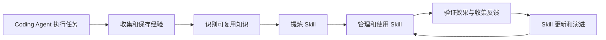

# P1a：Claude Code 适配、事件记录与隐藏评测隔离

日期：2026-11-08。依据：[冻结设计第 9 节](skill-extraction-design.md#9-claude-code-与控制面适配)、[开发计划](skill-prototype-development.md)、[P0b 验收底座](skill-prototype-p0b.md)。先明确本文件的范围与验收，再实施。

## 1 与最终闭环的关系

最终目标保持 issue 的完整闭环：



P1a 完成 A 的真实运行入口、B 的本地过程工件、E 的固定版本加载，以及 F 的结果回收和 P0 外部验收连接。P1b 才将合格来源工件写入 MemOS 并实际回读；P2 识别/提炼与 Skill Graph；P3 管理及人工发布；P4 对照效果；P5 更新与失效传播。人工编写的适配探针 Skill 只验证传输与执行机制，不能冒充从 Memory 提炼的成果或完整闭环。

## 2 本轮范围与技术选择

- 使用本机已安装 Claude Code CLI **2.1.296** 的 `-p --output-format stream-json`，不新增 Python Agent SDK。CLI 本身是官方提供的程序化入口；锁定 CLI 版本与可执行文件摘要，运行前后复核，不自动更新或使用 latest。
- 输入为注册 Case、精确 Skill revision（或无 Skill）、固定规则集合、内容摘要、允许工具、模型标识、预算与超时。独立运行目录保存任务副本；控制目录保存只读 Skill、设置与记录程序；可信侧保存事件、快照与 oracle。
- 配置白名单只借用用户既有认证/服务端点和选定模型，在内存中传入，不复制用户 hooks、插件、历史或其他 Skill。端点与凭据不写入仓库或可见任务，运行报告对敏感值脱敏。不改用户 HOME、现有 Claude 设置或已登录状态。
- 使用 `CLAUDE_CONFIG_DIR` 与显式设置来源、工具集合、MCP 配置固定运行上下文；不开 bare（本轮需要 hooks）。未知 alias 在调用模型前拒绝，不能接受 CLI 把未知命令退成普通 prompt 的行为。
- 首版隔离后端限定 **macOS sandbox-exec**，默认拒绝文件访问，只开放系统/CLI/Python 运行时、任务工作区和必要控制材料。隐藏任务资产、仓库、其他 Run、可信报告不可读写；Skill/设置/钩子只读。工具权限限制与沙箱共同作用，任何隔离能力缺失均拒绝启动，不回退到无隔离执行。该接口已被系统标为 deprecated；Linux/容器后端留作替代实现，不宣称跨平台已验收。
- 本轮只做本地实验授权的探针/候选使用，不实现 Release 服务、人工审批、Neo4j、数据库持久化、自动提炼或发布。本轮只加载单个固定工件；非空 requires 返回 capability_missing，不自动跟随 RELATED_TO 或 latest。

实现审阅补充的执行边界：P1a 只开放原生 Read/Edit/Write 和固定 MCP `run_visible_checks`、`record_rule`。不支持任意 Bash：仅扫描父子 PID 无法可靠追踪瞬时退出并脱离会话的后台命令。测试工具只执行控制面固定的 Python 可见检查，由沙箱外的宿主 broker 启动另一受限进程，禁止 fork、联网及任务文件写入，并限制时长和输出；输入不能指定命令。请求未支持的 shell 能力返回 capability_missing，不静默扩大权限。CLI 自身钩子及 MCP 服务是固定只读代码，模型不能引入其他进程入口。需要任意 shell/子进程的任务另待容器后端验收。

实现按“先失败测试 → 工件与事件 → OS 隔离 → 原生 CLI 运行与回收 → 实测报告”推进。分支 `codex/skill-prototype-p1a` 基于 `83244366`；功能与测试成组中文提交，不改写旧提交，不推送或合并。现有未跟踪 `bin/` 不动。

## 3 适配器最小契约

工件记录 `skill_id/revision/canonical_digest/rule_ids/requires`、导出器版本、唯一 runtime_alias、文件清单及 export_hash。导出是固定格式转换；冲突、路径逃逸、符号链接和内容漂移拒绝。每次执行前与回收后检查，运行中不切版。

RunContext 绑定 case/revision/split/lineage、run/attempt 和初始快照。模型不能改用途、版本或评分依据。实际模型由显式配置选择，保存请求及原生返回的标识；不能把代理报告的标识当成模型权重经过独立认证。

加载分为 prepared、discovered、native_expanded、observed_use。`system/init` 列表仅证明发现；`UserPromptExpansion` 证明该 alias 走原生展开路径，没有正文/hash。结合唯一 alias、封存工件、只读边界与锁版本的探针，才能给出本轮加载判定；缺事件或证据冲突保持 unknown/load_unverified。探针可在 Skill 正文中放置独有标记，观察其按指令使用，但不把复述标记视作正确修复或一般可靠性证明。

事件逐条带 collector sequence/event_id、run/attempt、来源类别、真实原生标识（缺失则为空）和完整性状态；区分 CLI 原生事件、工具动作与 Agent 规则声明。只记录公开行动、结果与简短判断，不采集私有推理。原始输出在内存中投影和脱敏后落盘，不能先把 thinking/凭据写成 JSONL 再清理。

规则记录只接受当前 revision 的规则 ID 与本次 Run 的事件引用。若使用 MCP 记录器，它仅证明声明被接收；实际动作须与原生工具事件及最终差异核对。没有观察证据的规则应用保持 unknown，不从最终成功反推全部规则已执行。

完成后停止本次进程及未决后台动作，核对控制工件，封存任务副本，调用 P0 独立验收；Agent 的 result success 不等于 task accepted。超时、断流、未配对工具事件和 hook 失败记 partial/capture_incomplete；采集错误不自动等于基础设施失败或可排除样本。适用性和严重违规的语义归因仍需任务证据与后续审阅。

## 4 验收标准

| 编号 | 通过条件 |
| --- | --- |
| C01 工件 | 精确 revision/hash/alias 固定，冲突、未知 alias、漂移与非法路径拒绝；无自动 latest |
| C02 原生加载 | 真正 Claude CLI 2.1.296 运行能观察发现与原生展开，并取得固定正文探针的使用证据；不是模拟输出 |
| C03 上下文 | 独立配置来源与固定工具集合；无用户插件/额外 Skill 或父级项目经验混入；固定 CLI 自带的两个 builtin 插件及 doctor/plugin-authoring 列入显式基线；不使用 bare |
| C04 事件 | 真正 Pre/Post 工具事件和最终结果被采集；原生 ID 不伪造；动作失败与采集不完整可区分 |
| C05 隐私 | thinking/signature 不落盘；凭据、认证头和显式敏感值脱敏；不收集私有推理 |
| C06 文件隔离 | 对隐藏 oracle、仓库、其他 Run 的直接读、符号链接读、子进程读和写均有 OS 拒绝证据；只读控制工件不能改 |
| C07 实际使用 | 至少一项 P0 dev 修复由真实 Claude 完成并由独立 oracle 验收，最终 receipt 与实际产物绑定；探针不是正式效果实验 |
| C08 拒绝与中断 | 未知命令/工件变更在运行前拒绝；缺必需权限、hook 异常/超时、任务超时或断流不能伪称成功；回收本次进程 |
| C09 可重复/并行 | 不覆盖旧 Run；运行目录/会话/事件隔离；一个 Run 不读取或修改另一个的文件与记录 |
| C10 回归 | 新单元与集成测试、P0 测试及相关公共 API/Dream 回归通过；Ruff 通过；报告真实命令和限制 |
| C11 证据口径 | 报告分别呈现加载、采集、任务验收与来源资格；手工探针和 mocked 测试不计作已提炼 Skill 或真实来源经验 |

真实验证只使用 dev 探针，不把 holdout 交给正在调试的适配器。预算在每次运行前显式设置，小规模验证优先；模型费用采用原生报告字段，无法取得则标未知，不估造账单。认证或服务不可用时保留失败事实，继续完成可独立验证的工作，不能填造实际成功。

## 5 官方依据与待验证假设

已核对官方 [Skills](https://code.claude.com/docs/en/skills)、[Hooks](https://code.claude.com/docs/en/hooks#userpromptexpansion)、[程序化运行](https://code.claude.com/docs/en/headless) 与 [CLI 参数](https://code.claude.com/docs/en/cli-reference)。使用原生命令及 command hooks；`--allowedTools` 是免提示授权，工具集合另由 `--tools` 固定；`--settings` 本身不会清除其他配置，隔离必须另做。2.1.296 支持 command hook 的 `onFailure: block`，仍以实际失败探针校验其行为，不将 hook 视作 OS 沙箱。

实施前已确认 CLI 版本与认证状态；Docker daemon 未运行。临时 OS 探针已证明沙箱可拒绝直接、symlink 与子进程越界，当时将实际 Claude 的运行时、网络及事件表现列为待实测项；其后结果已补入第 6 节。SDK、平台或工具变化都需重新验收，不继承本次结果。

## 6 实施与验证记录

实现位于 `src/memos/skill_adapter/`，不修改生产 Memory、Dream、API 行为，不新增依赖。

| 模块 | 责任 |
| --- | --- |
| `artifacts.py` | 精确 SkillRevision、静态正文校验、原生 SKILL.md/manifest 导出及重验 |
| `events.py` | 原生 stream/hook 双通道配对、session 绑定、公开数据投影和统一脱敏、规则声明 |
| `hooks.py` | 每次钩子检查固定正文摘要，记录原生命令/工具 ID；失败阻断 |
| `recording_server.py` | 无 Skill/有 Skill 的固定 MCP 工具；规则声明及无命令参数的可见检查请求 |
| `broker.py` | 每 Run 独立 Unix socket、封存测试输入、宿主启动固定检查、时限/输出限额、返回 check_index/候选摘要 |
| `isolation.py` | 默认拒绝的 macOS 策略、精确运行时/socket、影子配置保护、跨进程信息限制及真实 OS 探针 |
| `verification.py` | 无凭据、无网络、禁止 fork 的最终验收；有界输出先脱敏，隔离策略与实现摘要进入 P0 receipt |
| `runner.py` / `__main__.py` | 配置和 CLI 版本前检、原生运行、失败保留、最终快照/外部验收、分项报告与命令入口 |

P0 `verify_candidate` 只增加可选 executor 参数，原默认行为保留；P1a 必须使用受限 executor。receipt 重验同时检查隔离 profile 与执行器源码摘要，源码变化需要重新验收。适配器另保存原始任务快照、最终快照、事件摘要和 receipt 摘要，捕获期间 CLI 或适配器源码漂移会阻断成功。非法最终树保留为 quarantine，不能作为合法候选使用。

**完成状态：P1a 的 C01–C11 已在声明范围内完成验证。** 最终实现代码提交为 `5406e769`，后续提交只补充文档。测试与实际运行严格分开记录：

| 验证 | 实际结果 |
| --- | --- |
| `pytest tests/skill_adapter tests/skill_evaluation -q` | 384 passed，55.73 秒；其中 P1a 172 项、既有 P0 212 项 |
| 相关公共 SkillMemory / Dream / update_memory 回归 | 39 passed，3.12 秒 |
| 改动范围 Ruff check / format --check | 全部通过，20 个 Python 文件格式一致 |
| Git pre-commit | 三条功能提交全部通过；可空参数注解由提交钩子要求修正后重新验证 |
| 独立审阅 | APPROVE；审阅了原生证据、候选绑定、错误判定、隔离及脱敏；修复发现的问题后收口 |

最终固定 Skill 原生运行 `4b434cf2432242ee9d046a4be941f6c4`：Claude Code 2.1.296，明确模型 `claude-opus-5-5`，effort=low，180 秒/12 轮/原生估价上限 1.5 USD。实际 27.391 秒、8 轮、7 次工具调用；每次都有 stream 的开始/完成与同 session/tool ID 的 Pre/Post 钩子，另有 SessionStart、UserPromptSubmit、UserPromptExpansion、Stop。发现、原生展开、正文探针使用和上下文核对全部通过；capture=complete、native_outcome=reported_success、overall=passed。CLI 报告估算 0.0688336 USD，非服务商账单。

该运行只修改 `caller.py`，保留严格 Fake 与可见测试。四项外部验收 `caller_contract`、`fake_valid_update`、`fake_rejects_invalid_call`、`caller_with_fake` 均通过。实际最终候选摘要 `022be3b4f65713b33c80f6c44c0684549c1770f0df33ea8a6d26189156206172` 与当前 `check_receipt` 匹配；事件哈希也匹配。适配器实现摘要 `b0c192a826a9b28d455e1d75afee094b1033212422d02c13e5f235b7bbf13585` 经运行前后及提交后再次核对，未发生漂移。

手写探针为 `contract-repair-probe` revision `1`，canonical digest `3da42234c012dc2bfac84fe53f253a078bb070852bc8c31168729547376d0a31`，原生 alias `mem-contract-repair-probe-r1-3da42234c012`。R3 声明已记录，仍为 declared_only，未把自述升级为规则的执行证明。该探针只检验适配能力；qualified_agent_experience=false、effectiveness_evaluation=false。

开发过程还保留了以下实际负例，而非只依赖模拟：

- 原生 hook 因运行时路径权限失败，CLI 却返回 success 文本：采集器依据 hook 失败拒绝成功。
- 模型请求因完整消息 URL 被误作服务根地址而失败：保留 reported_error；只修正本次输入，未改用户原设置。
- 无 Skill 的租户修复已通过外部验收，但 CLI 达到 12 轮上限（error_max_turns/is_error=true），缺少最终 Stop/完整工具钩子：overall 仍为 incomplete，未把有效补丁当成完整会话。
- 只给 Read、不提供 Edit/Write：最终运行 `743ddd6b80be4aab9f97bcf44ba3344b` 用时 96.051 秒，原生 reported_success、capture=complete，但候选与初始快照完全相同，外部验收 failed，overall 为 incomplete；当前源码、事件与失败回执绑定均匹配。
- 提交钩子改动源码时，进行中的运行检测到 artifact_mismatch，即使 CLI 正常退出仍为 partial；随后以提交后的固定实现重新运行取得上面的最终通过证据。

上述失败报告不回改为通过；源码/隔离实现摘要变化后，旧 receipt 作为历史记录保留，不能冒充当前实现下有效的验收。原生验证都只使用 dev；没有向调试中的 Agent 提供 holdout，也没有运行正式效果对照实验。并行运行使用不同 run/session、工作区、socket、事件和快照，OS 测试实际验证跨运行读取/写入拒绝。

收口中通过先失败再修复发现：动态 Skill 参数逃逸、缺原生 hooks 却被判完整、跨 session 事件混入、影子配置写入、DNS 运行时权限、不可嵌套 sandbox-exec、跨进程环境读取、候选验收绕过宿主隔离、未检查 native is_error、公共输出脱敏旁路与 JSON 敏感键漏出。所有有意注入的凭据均为合成 canary；未读取其他进程的真实凭据。

没有运行全仓测试；以上结果支持固定 dev/source 任务资产、当前本地运行环境和列出的适配边界，不证明 Skill 的普遍效果。运行工件由操作者保存在仓库外，未提交认证配置、私有端点或原始私有推理。

## 7 进入 P1b 的剩余工作

P1b 将把真实来源运行形成证据包：补齐环境/任务/合同/最终补丁/验收绑定及经验资格；按 run/attempt 幂等落库；区分受理 task_id 与实际 Memory ID；实际回读生成 MemorySnapshot；记录来源变化；source/dev/holdout 在存储与检索出口隔离。两例来源经验必须实际运行，不能用本轮人工 Skill 或标准补丁替代。之后才连接多记忆提炼、图组织、人工发布及演进闭环。

| P1b 工作包 | 需要补齐的功能 | 阶段验收 |
| --- | --- | --- |
| P1b-1 来源采集 | 以无 Skill 模式真实执行 S1/S2，完整保留失败和重试；固定模型、任务和预算 | 两个来源任务由 Agent 产生最终候选，独立验收及绑定通过；重复 attempt 不当成独立案例 |
| P1b-2 最小证据包 | 将 P1a 的事件/环境/初始与最终快照/检查证据转为冻结 schema，生成补丁及来源资格判断 | 必需字段缺失阻止提炼；declared_only 不升级为规则执行证明；失败和未决信息不丢失 |
| P1b-3 MemOS 持久化 | 幂等写入、受理 task_id 与实际 Memory ID 区分、重试与部分失败恢复 | 重复投递不产生重复经验；收到受理回执不能宣布已入库；模型/存储环境必须实际连通 |
| P1b-4 实际回读 | 读取 Memory 正文/元数据形成 MemorySnapshot，绑定版本与内容摘要，保留来源变化 | 回读可追溯到 run/attempt/最终候选/receipt；内容变化使旧 snapshot 失效；source 与 holdout 在写入和检索出口隔离 |

Neo4j 已选为 Skill Graph 后端，但图节点、提炼和发布仍属 P2/P3；P1b 先验证实际 MemOS 记忆写入与读回通路，不用只有数据库连接成功的探针代替完整证据链。


## 8 维护者使用方式

在 macOS 的已验证环境使用项目 `.venv`。模型必须是明确 ID；CLI 版本固定 2.1.296，运行前先检查版本。`--cli-path` 指向已验收的原生可执行文件；npm wrapper 与 Node 的组合运行时尚未单独验收。已有凭据通过进程环境提供，命令行、Skill JSON 和仓库均不得包含凭据。`ANTHROPIC_BASE_URL` 应为服务根地址，不能把完整 `/v1/messages` 接口地址当作根地址；本轮实测纠正了这一输入问题，未修改用户配置文件。

```bash
PYTHONPATH=src .venv/bin/python -m memos.skill_adapter run dev-strict-signature \
  --output /tmp/memos-p1a-example/run \
  --cli-path /absolute/path/to/claude \
  --model FIXED_MODEL_ID --timeout 180 --max-turns 12 --max-budget 1.5 \
  --skill-json /absolute/path/to/fixed-probe.json
```

`fixed-probe.json` 的字段为 `skill_id`、字符串 `revision`、`body`、`rule_ids` 数组，可选 `requires` 数组；重复/未知字段拒绝。本版依赖非空会报告 capability_missing，未实现多工件依赖加载。正文禁止动态参数和命令替换。无 `--skill-json` 是无 Skill 运行；source 仅允许该模式；holdout 在 P1a 入口拒绝。默认 effort=low，明确写入报告；Python API 可固定 low/medium/high。预算字段采用 CLI 的原生计价估算，不冒充服务商实际账单。

CLI 返回：报告 passed 为 0，已记录但未完整通过为 1，输入/前置能力错误为 2。公共包初始化可能先输出既有诊断日志，最终工件以 report.json 为准。目录已存在则拒绝覆盖。

主要工件：`events.jsonl`、`isolation.json`、`snapshots/`、`candidate/`、`visible-checks/check-N.json`、`validation/runs/<run>/<attempt>/receipt.json`、`report.json`。`loading`、`capture`、`task_status` 分开解释；failed receipt 也可能完整匹配，不能只看 receipt_matches。

```bash
.venv/bin/python -m pytest tests/skill_adapter tests/skill_evaluation -q
.venv/bin/python -m pytest tests/api/test_public_no_skill.py tests/dream/test_persistence.py tests/api/test_update_memory.py -q
.venv/bin/ruff check src/memos/skill_adapter tests/skill_adapter src/memos/skill_evaluation/verifier.py
.venv/bin/ruff format --check src/memos/skill_adapter tests/skill_adapter src/memos/skill_evaluation/verifier.py
```

## 9 已验证边界与限制

- 原生 CLI 会保留固定 builtin 插件，即使设置 disableBundledSkills。适配器核对实际 tools/model/skills/plugins/MCP，与显式基线不符就拒绝成功；系统受管配置存在时拒绝这套实验前提，不绕过组织政策。该检查不能证明服务端实际模型权重未被代理重映射。
- macOS 不允许在本方案的沙箱内再次应用 sandbox-exec，因此采用宿主 broker。OS 探针除直接文件、symlink、子进程、写入外，还覆盖其他进程/父进程环境信息，防止通过 sysctl 绕过文件限制。其他平台和任意 shell 的生命周期尚未验收。
- 原生流的 thinking/redacted_thinking 和 system/thinking_tokens 进度不落盘；记录公开行动、公开结果及最终 token/费用计数。未知事件仍使采集 partial。凭据过滤涵盖事件、MCP 检查结果、验收日志/报告；原生 stderr 只计字节数，不保留原文。
- 原生展开事件不包含正文，加载证据依赖固定 alias、只读工件、前后摘要及正文探针的联合判断。它不是对模型内部注意力或全部规则执行的证明。
- `record_rule` 是 Agent 声明，缺少本次原生事件引用时为 declared_only；check_index/候选摘要连接实际工具结果与可信检查工件，但不自动把一条规则认定为正确应用。P1b 需补充可审阅的证据包及资格判定。
- 最终 oracle 与候选仍在同一个 Python 解释器。OS 隔离保护宿主、其他任务和 Agent 的可见范围；不能防止蓄意恶意 Python 使用反射篡改进程内 oracle。当前只用于受控修复实验，不是恶意代码执行服务；正式对抗性评测需独立进程协议或容器/VM方案。
- CLI 为调用模型需要联网，当前网络策略未按域名限制，不证明其他获准远端服务不包含相同数据。可见测试/隐藏验收子进程不联网、不继承模型凭据。固定任务源文件自身应无私密信息；精确候选快照不通过改写源代码来脱敏。
- 本轮真实探针只验证适配能力，没有执行 holdout，没有计算 Skill 增益，没有生成合格来源 Memory。完整闭环仍依次需要 P1b、P2、P3、P4、P5。


## 10 分支与提交

分支 `codex/skill-prototype-p1a`，基于 P0b 的 `83244366`。本轮按范围提交，所有提交信息为中文，未推送或合并：

- `cedcf6f4` — docs: 明确 P1a 适配范围与真实验证标准
- `28488a0f` — feat: 增加固定 Skill 工件与原生事件记录契约
- `3aeaba0a` — feat: 隔离任务执行并绑定受控测试与隐藏验收
- `5406e769` — feat: 接通 Claude Code 固定上下文运行与结果回收
- 本记录随 `docs: 记录 P1a 实测结果与 P1b 交付门槛` 提交；只更新开发计划与本文件。

最终独立审阅再次核对了提交后两次原生运行与当前源码摘要，结论 APPROVE。原有未跟踪 `bin/` 保持原状。
